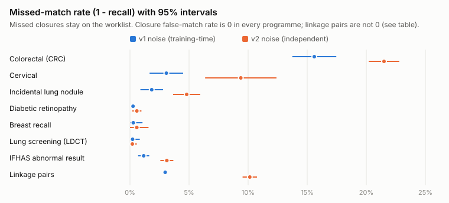
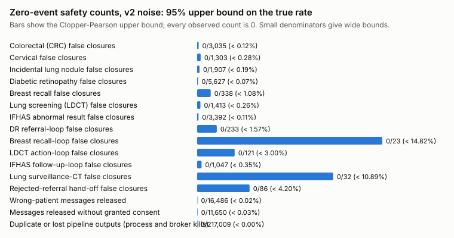
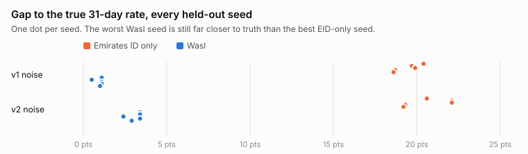
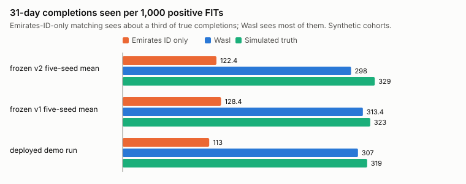
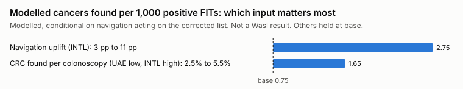

# Evidence: what Wasl measured, how, and how to check it

Generated by `scripts/evidence.py` from `pipeline/results/final/summary.json` (code revision `075abc5ad04a`, frozen 2026-11-02T04:33Z). Do not edit by hand; run `python3 scripts/evidence.py`. Machine-readable copy: `web/data/evidence.json`. All patients are synthetic.

## Verify it yourself

- `make verify` (runs `scripts/verify.sh`): regenerates held-out cohorts, checks committed hashes, prints PASS or FAIL per ledger row.
- `make verify SEED=<any integer>`: the same on a cohort nobody has seen.
- `python3 scripts/evidence.py --check && python3 -m unittest scripts/test_evidence.py`: every number below traces to the frozen summary or a cited parameter.

## Error definitions

These are the definitions the frozen evaluation already used. They were fixed in code (`pipeline/report7.go`, `pipeline/analyze.go`, `pipeline/audit.go`, `scripts/final_aggregate.py`) and recorded with thresholds, model hashes and seeds in `pipeline/results/final/manifest.json` at revision `075abc5ad04a`, frozen 2026-11-02T04:33Z, before the held-out runs (`scripts/final_eval.sh` refuses to run on a dirty tree). No new pre-registration is claimed. The labels on the 43 report texts were completed after the freeze; `pipeline/results/final/annotation-provenance.json` records that.

| Term | Meaning |
|---|---|
| False closure (primary safety error) | A loop Wasl's final live decision marks closed while the simulator's hidden truth says it is not closed. Counted per programme on loops Wasl closed (report7 closure.<programme>.wasl_live_with_review.false_closures; pipeline/report7.go closureStatsDecisions, pipeline/analyze.go closureStatsProg), pooled over seeds, with a Clopper-Pearson 95% upper bound (scripts/final_aggregate.py). The frozen run counts false outcomes only; the later evidence-ownership check (#193) is not part of it. The patient drops off the worklist, so this is the dangerous error. |
| False open (missed closure) | A loop the truth says is closed but Wasl leaves open (closure 'missed'). Rate = 1 - closure recall. It creates extra review or chase work; the patient stays visible. |
| Wrong-patient merge | Two registrations of different people placed in one linker cluster (report7 linkage.false_merge_pairs; pipeline/audit.go linkMetrics). Pair false-match rate = 1 - pair precision. Its clinical consequences are measured separately as false closures and as wrong-patient messages released (an outreach message whose triggering record belongs to someone other than the loop's patient; pipeline/sweep.go govMetrics). |
| Missed match | Two registrations of the same person left in different clusters. Pair missed-match rate = 1 - pair recall over all true same-person pairs. |
| Closure false-match / missed-match rate | The same two rates at the level of each programme's loops: 1 - closure precision and 1 - closure recall, with the evaluation's 95% t-intervals over five seeds. |
| Review band | Items routed to a human reviewer instead of an automatic decision, per 100 loops, and simulated reviewer hours per 1,000 loops. |
| Pre-registration | Code revision 075abc5ad04a with thresholds, policy v7strict, model and data hashes and seeds [11, 23, 37, 41, 59] recorded in pipeline/results/final/manifest.json, frozen 2026-11-02T04:33Z before the held-out runs. v2 noise was never used for training, calibration or rule design; the v7 rules were designed on earlier v1-noise seeds. |

No published standard defines an acceptable false-closure rate for screening follow-up. Wasl's closure tier (0.99) and double human review are the team's own policy.

## Accuracy

False-match rate is 1 - precision, missed-match rate is 1 - recall (Harron et al. 2017). Means over five held-out seeds with 95% t-intervals; the interval reflects generator variance between seeds. F1 comes last because it is not comparable across linkers.

| Metric | v1 noise (training-time) | v2 noise (independent) |
|---|---|---|
| Colorectal (CRC): closure false-match rate (1 - precision) | 0.00% (0.00% to 0.00%) | 0.00% (0.00% to 0.00%) |
| Colorectal (CRC): closure missed-match rate (1 - recall) | 15.60% (13.74% to 17.46%) | 21.50% (20.21% to 22.79%) |
| Cervical: closure false-match rate (1 - precision) | 0.00% (0.00% to 0.00%) | 0.00% (0.00% to 0.00%) |
| Cervical: closure missed-match rate (1 - recall) | 3.08% (1.66% to 4.50%) | 9.38% (6.36% to 12.40%) |
| Incidental lung nodule: closure false-match rate (1 - precision) | 0.00% (0.00% to 0.00%) | 0.00% (0.00% to 0.00%) |
| Incidental lung nodule: closure missed-match rate (1 - recall) | 1.84% (0.88% to 2.80%) | 4.80% (3.65% to 5.95%) |
| Diabetic retinopathy: closure false-match rate (1 - precision) | 0.00% (0.00% to 0.00%) | 0.00% (0.00% to 0.00%) |
| Diabetic retinopathy: closure missed-match rate (1 - recall) | 0.26% (0.12% to 0.40%) | 0.58% (0.19% to 0.97%) |
| Breast recall: closure false-match rate (1 - precision) | 0.00% (0.00% to 0.00%) | 0.00% (0.00% to 0.00%) |
| Breast recall: closure missed-match rate (1 - recall) | 0.28% (-0.50% to 1.06%) | 0.58% (-0.41% to 1.57%) |
| Lung screening (LDCT): closure false-match rate (1 - precision) | 0.00% (0.00% to 0.00%) | 0.00% (0.00% to 0.00%) |
| Lung screening (LDCT): closure missed-match rate (1 - recall) | 0.22% (-0.39% to 0.83%) | 0.20% (-0.18% to 0.58%) |
| IFHAS abnormal result: closure false-match rate (1 - precision) | 0.00% (0.00% to 0.00%) | 0.00% (0.00% to 0.00%) |
| IFHAS abnormal result: closure missed-match rate (1 - recall) | 1.16% (0.69% to 1.63%) | 3.12% (2.57% to 3.67%) |
| Linkage pairs: false-match rate (1 - pair precision) | 1.10% (0.82% to 1.38%) | 0.92% (0.74% to 1.10%) |
| Linkage pairs: missed-match rate (1 - pair recall) | 2.98% (2.80% to 3.16%) | 10.14% (9.53% to 10.75%) |
| Review band: review items per 100 loops | 36.8898 (36.1299 to 37.6497) | 33.5584 (32.3128 to 34.804) |
| Review band: reviewer hours per 1,000 loops | 12.82 (12.4863 to 13.1537) | 11.6316 (10.9639 to 12.2993) |
| Linkage pair F1 (not comparable across linkers) | 0.9794 (0.978 to 0.9808) | 0.9422 (0.9381 to 0.9463) |

The closure false-match rate is 0 with a zero-width interval because every seed had precision 1.000; read it with the safety table's upper bounds, not as a certainty. t-intervals near 0 can dip below 0 (breast, LDCT); they are shown as the evaluation computed them. The linker does make wrong-patient merges (about 1% of linked pairs); the closure gate, a second identifier and human review stop them from closing loops or messaging the wrong person in these runs.

### Safety

False closures first. Pooled over five seeds; the upper bound is the two-sided Clopper-Pearson 95% bound for the true rate when 0 events were seen.

| Safety count | Events | Denominator | 95% upper bound |
|---|---|---|---|
| [v1] Colorectal (CRC) false closures | 0 | 3,161 | 0.117% |
| [v1] Cervical false closures | 0 | 1,407 | 0.262% |
| [v1] Incidental lung nodule false closures | 0 | 2,022 | 0.182% |
| [v1] Diabetic retinopathy false closures | 0 | 5,634 | 0.065% |
| [v1] Breast recall false closures | 0 | 345 | 1.064% |
| [v1] Lung screening (LDCT) false closures | 0 | 1,398 | 0.264% |
| [v1] IFHAS abnormal result false closures | 0 | 3,480 | 0.106% |
| [v1] DR referral-loop false closures | 0 | 267 | 1.372% |
| [v1] Breast recall-loop false closures | 0 | 31 | 11.219% |
| [v1] LDCT action-loop false closures | 0 | 109 | 3.328% |
| [v1] IFHAS follow-up-loop false closures | 0 | 1,140 | 0.323% |
| [v1] Lung surveillance-CT false closures | 0 | 41 | 8.604% |
| [v1] Rejected-referral hand-off false closures | 0 | 88 | 4.105% |
| [v1] Wrong-patient messages released | 0 | 17,063 | 0.022% |
| [v1] Messages released without granted consent | 0 | 11,828 | 0.031% |
| [v1] Duplicate or lost pipeline outputs (process and broker kills) | 0 | 220,789 | 0.002% |
| [v1] Forged events with any effect | 0 | 110 | – |
| [v1] Tamper attacks not detected | 0 | 85 | – |
| [v1] Wrong-patient merge pairs in linker clusters (not zero; see definitions) | 578 | – | – |
| [v2] Colorectal (CRC) false closures | 0 | 3,035 | 0.121% |
| [v2] Cervical false closures | 0 | 1,303 | 0.283% |
| [v2] Incidental lung nodule false closures | 0 | 1,907 | 0.193% |
| [v2] Diabetic retinopathy false closures | 0 | 5,627 | 0.066% |
| [v2] Breast recall false closures | 0 | 338 | 1.085% |
| [v2] Lung screening (LDCT) false closures | 0 | 1,413 | 0.261% |
| [v2] IFHAS abnormal result false closures | 0 | 3,392 | 0.109% |
| [v2] DR referral-loop false closures | 0 | 233 | 1.571% |
| [v2] Breast recall-loop false closures | 0 | 23 | 14.819% |
| [v2] LDCT action-loop false closures | 0 | 121 | 3.003% |
| [v2] IFHAS follow-up-loop false closures | 0 | 1,047 | 0.352% |
| [v2] Lung surveillance-CT false closures | 0 | 32 | 10.888% |
| [v2] Rejected-referral hand-off false closures | 0 | 86 | 4.199% |
| [v2] Wrong-patient messages released | 0 | 16,486 | 0.022% |
| [v2] Messages released without granted consent | 0 | 11,650 | 0.032% |
| [v2] Duplicate or lost pipeline outputs (process and broker kills) | 0 | 217,009 | 0.002% |
| [v2] Forged events with any effect | 0 | 106 | – |
| [v2] Tamper attacks not detected | 0 | 85 | – |
| [v2] Wrong-patient merge pairs in linker clusters (not zero; see definitions) | 448 | – | – |

### Worst seed and worst stratum

| | |
|---|---|
| [v1] CRC closure recall, worst and best seed | 0.818 (seed 37) to 0.855 (seed 41) |
| [v1] Linkage pair recall, worst and best seed | 0.968 (seed 41) to 0.972 (seed 23) |
| [v1] Largest Wasl 31-day KPI gap to truth, by seed | 1.1 points (seed 11: Wasl 0.324, truth 0.335, EID-only 0.131) |
| [v1] CRC recall by age band, worst stratum | 40-59: 0.815 (range 0.815 to 0.867); false closures 0 in every stratum |
| [v1] CRC recall by sex, worst stratum | M: 0.834 (range 0.834 to 0.848); false closures 0 in every stratum |
| [v1] Review load by name origin, heaviest group | south_asian: 37.9 items per 100 loops (max/min 1.0481, p = 0.451; by programme 1.0993, p = 0.01) |
| [v2] CRC closure recall, worst and best seed | 0.767 (seed 41) to 0.792 (seed 59) |
| [v2] Linkage pair recall, worst and best seed | 0.891 (seed 41) to 0.904 (seed 23) |
| [v2] Largest Wasl 31-day KPI gap to truth, by seed | 3.4 points (seed 11: Wasl 0.289, truth 0.323, EID-only 0.117) |
| [v2] CRC recall by age band, worst stratum | <40: 0.766 (range 0.766 to 0.798); false closures 0 in every stratum |
| [v2] CRC recall by sex, worst stratum | F: 0.785 (range 0.785 to 0.786); false closures 0 in every stratum |
| [v2] Review load by name origin, heaviest group | filipino: 35.4 items per 100 loops (max/min 1.124, p = 0.007; by programme 1.0653, p = 0.185) |

Name-origin recall is not reported by the frozen evaluation; review load by origin is. With about 16 subgroup tests per evaluation, no highlighted p-value passes a Bonferroni cut (about 0.003).

## Impact: measured

Wasl changes what the programme can see, not what patients do. Per 1,000 positive FITs, from the 31-day completion rates. It assumes Wasl's detected completions are true completions, which the 0 false closures above support.

| Per 1,000 positive FITs | Emirates ID only | Wasl | Simulated truth | Unit |
|---|---|---|---|---|
| Completions seen within 31 days (frozen v2 five-seed mean) | 122.4 | 298 | 329 | per 1,000 positive FITs |
| Share of true completions seen (frozen v2 five-seed mean) | 37.2 | 90.6 | 100 | % |
| Patients wrongly flagged 'not followed up' (frozen v2 five-seed mean) | 206.6 | 31 | 0 | per 1,000 positive FITs |
| Worklist size (patients to chase) (frozen v2 five-seed mean) | 877.6 | 702 | 671 | per 1,000 positive FITs |
| Worklist precision (share of listed patients truly not done) (frozen v2 five-seed mean) | 76.5 | 95.6 | – | % |
| Completions seen within 31 days (frozen v1 five-seed mean) | 128.4 | 313.4 | 323 | per 1,000 positive FITs |
| Share of true completions seen (frozen v1 five-seed mean) | 39.8 | 97 | 100 | % |
| Patients wrongly flagged 'not followed up' (frozen v1 five-seed mean) | 194.6 | 9.6 | 0 | per 1,000 positive FITs |
| Worklist size (patients to chase) (frozen v1 five-seed mean) | 871.6 | 686.6 | 677 | per 1,000 positive FITs |
| Worklist precision (share of listed patients truly not done) (frozen v1 five-seed mean) | 77.7 | 98.6 | – | % |
| Completions seen within 31 days (deployed demo run) | 113 | 307 | 319 | per 1,000 positive FITs |
| Share of true completions seen (deployed demo run) | 35.4 | 96.2 | 100 | % |
| Patients wrongly flagged 'not followed up' (deployed demo run) | 206 | 12 | 0 | per 1,000 positive FITs |
| Worklist size (patients to chase) (deployed demo run) | 887 | 693 | 681 | per 1,000 positive FITs |
| Worklist precision (share of listed patients truly not done) (deployed demo run) | 76.8 | 98.3 | – | % |

Plain reading (v2, the independent noise model): EID-only matching wrongly flags about 207 of every 1,000 positives as not followed up; Wasl about 31. Wasl raises the measured rate toward the true rate. The real rate moves only if someone acts on the list.

Chase time spent on patients who were already done falls by 176 contacts per 1,000 positives; at 5 to 20 minutes per chase (ASSUMED) that is 15 to 59 navigator hours per 1,000 positives.

### Calibration point

Abu Dhabi FIT+ patients with a follow-up colonoscopy (SEHA ambulatory clinics, 2015-16): **30.5%** ([BMC Cancer 2021](https://pmc.ncbi.nlm.nih.gov/articles/PMC8343888/)). The simulated truth is 32.9% (v2 mean) and 31.9% (deployed run); EID-only measurement is 12.2%. Caveats: No fixed 31-day window (median 72 days), and only colonoscopies inside SEHA's own network were counted, so it may undercount completions done elsewhere. The simulated truth sitting near it is a plausibility check, not a validation.

## Modelled benefit

**Modelled, conditional on navigation acting on the corrected list.** This is not a Wasl result. NICE ESF / ISPOR budget-impact shape: a range of scenarios and a tornado, not a point estimate.

| Scenario | Navigation uplift | CRC per colonoscopy | Extra colonoscopies per 1,000 positives | Cancers found per 1,000 positives |
|---|---|---|---|---|
| worst (measurement benefit only) | 0 pp | – | 0 | 0 |
| base | 3 pp | 2.5% | 30 | 0.75 |
| best | 11 pp | 5.5% | 110 | 6.05 |

| Input (others at base) | Low | High | Cancers per 1,000 at low | at high |
|---|---|---|---|---|
| Navigation uplift (INTL) | 3 pp | 11 pp | 0.75 | 2.75 |
| CRC found per colonoscopy (UAE low, INTL high) | 2.5% | 5.5% | 0.75 | 1.65 |

Scale: cancers a year = per 1,000 x positive FITs a year / 1,000. At 1,000 to 10,000 positives a year (ASSUMED) the base case gives 0.75 to 7.5 and the best case 6.05 to 60.5 cancers found a year.

Delay harm is used qualitatively only: longer waits after a positive FIT are associated with more advanced disease in observational studies. No lives-saved figure is claimed.

### Parameter provenance

| Parameter | Value | Scope | Source |
|---|---|---|---|
| FIT+ patients with a follow-up colonoscopy, SEHA ambulatory clinics 2015-16 | 30.5% | UAE | [Abu Dhabi SEHA cohort, BMC Cancer 2021](https://pmc.ncbi.nlm.nih.gov/articles/PMC8343888/) |
| 31-day standard: colonoscopy within 31 days of referral after FIT+ | 31 days | UAE | [DoH colorectal cancer screening specification, Appendix 2](https://www.doh.gov.ae/-/media/980F1D8087214B6D9E630B457B85E4B9.ashx) |
| Navigation uplift in colonoscopy completion (low) | 3 pp | INTL | [Selby et al. 2021, J Med Screen: about 3 points per extra intervention](https://doi.org/10.1177/0969141320904977) |
| Navigation uplift in colonoscopy completion (high) | 11 pp | INTL | [Selby et al. 2021, J Med Screen: programmes with navigators, 6-month completion](https://doi.org/10.1177/0969141320904977) |
| CRC found per completed colonoscopy after FIT+ (low) | 2.5% | UAE | [SEHA cohort, 11 cancers in 436 colonoscopies (team's arithmetic)](https://pmc.ncbi.nlm.nih.gov/articles/PMC8343888/) |
| CRC found per completed colonoscopy after FIT+ (high) | 5.5% | INTL | [Korean national programme](https://pmc.ncbi.nlm.nih.gov/articles/PMC5832343/) |
| Positive FITs per year in the illustrative scenarios | 1,000-10,000 | ASSUMED | [Illustrative. SEHA had about 685 positives a year in one network (team's annualisation); ADPHC reports screenings up more than 280% in 2025](https://menafn.com/1111766961/Abu-Dhabi-Records-More-Than-280-Increase-in-Cancer-Screenings-and-Strengthens-Adoption-of-Preventive-Health-Behaviours) |
| Navigator minutes per chase contact | 5-20 min | ASSUMED | No Abu Dhabi figure exists; varied as an assumption |
| Malaffi unique patient profiles vs emirate population | 14 million vs 4.14 million | UAE | [Malaffi progress report; SCAD 2024 population. Suggests identity fragmentation (inference, not a duplicate rate)](https://www.malaffi.ae/malaffi-progress-report/) |

UAE = published Abu Dhabi or UAE figure; INTL = borrowed from another country; ASSUMED = no source; used only as a stated range.

## Public benchmarks

| Benchmark | Dataset | Metric | Wasl | Baseline | Note |
|---|---|---|---|---|---|
| FEBRL4 linkage precision, names + DOB | [FEBRL4](https://recordlinkage.readthedocs.io/en/latest/ref-datasets.html) | precision | 0.978983 | 0.943 (preclink 1.2.0 README benchmark table (recordlinkage recipe in examples/benchmark_febrl.py): https://pypi.org/project/preclink/1.2.0/) | FEBRL4 (5,000 + 5,000 synthetic Australian records, known 1:1 mapping; not made by the team). Wasl config names_dob: name = given + surname, DOB; no sex, no ID (FEBRL's 7-digit soc_sec_id cannot fill the Emirates-ID slot); encoder, features, LightGBM scorer, 0.7 union threshold and merge rules unchanged; final clusters scored. Wasl 0.979 [0.974, 0.983] (4332/4425), Wilson 95%. Baseline uses address, suburb and postcode (fields Wasl does not have) and blocks on postcode; reproduced exactly by recordlinkage 0.16 rerun by scripts/bench_febrl_recordlinkage.py. |
| FEBRL4 linkage recall, names + DOB | [FEBRL4](https://recordlinkage.readthedocs.io/en/latest/ref-datasets.html) | recall | 0.8664 | 0.808 (preclink 1.2.0 README benchmark table (recordlinkage recipe in examples/benchmark_febrl.py): https://pypi.org/project/preclink/1.2.0/) | FEBRL4 (5,000 + 5,000 synthetic Australian records, known 1:1 mapping; not made by the team). Wasl config names_dob: name = given + surname, DOB; no sex, no ID (FEBRL's 7-digit soc_sec_id cannot fill the Emirates-ID slot); encoder, features, LightGBM scorer, 0.7 union threshold and merge rules unchanged; final clusters scored. Wasl 0.866 [0.857, 0.876] (4332/5000), Wilson 95%. Baseline uses address, suburb and postcode (fields Wasl does not have) and blocks on postcode; reproduced exactly by recordlinkage 0.16 rerun by scripts/bench_febrl_recordlinkage.py. |
| FEBRL4 linkage F1, names + DOB | [FEBRL4](https://recordlinkage.readthedocs.io/en/latest/ref-datasets.html) | f1 | 0.919257 | 0.87 (preclink 1.2.0 README benchmark table (recordlinkage recipe in examples/benchmark_febrl.py): https://pypi.org/project/preclink/1.2.0/) | FEBRL4 (5,000 + 5,000 synthetic Australian records, known 1:1 mapping; not made by the team). Wasl config names_dob: name = given + surname, DOB; no sex, no ID (FEBRL's 7-digit soc_sec_id cannot fill the Emirates-ID slot); encoder, features, LightGBM scorer, 0.7 union threshold and merge rules unchanged; final clusters scored. 4425 predicted pairs, 4332 correct. |
| FEBRL4 linkage F1, same fields as Wasl | [FEBRL4](https://recordlinkage.readthedocs.io/en/latest/ref-datasets.html) | f1 | 0.919257 | 0.850871 (recordlinkage 0.16 rerun by scripts/bench_febrl_recordlinkage.py (published recipe restricted to given name, surname, DOB)) | Equal-information comparison. Baseline precision 0.980 [0.975, 0.984] (3760/3838), recall 0.752 [0.740, 0.764] (3760/5000); Wasl precision 0.979 [0.974, 0.983] (4332/4425), recall 0.866 [0.857, 0.876] (4332/5000). |
| FEBRL4 false-match rate, names + DOB | [FEBRL4](https://recordlinkage.readthedocs.io/en/latest/ref-datasets.html) | false_match_rate | 0.0134 | 0.0446 (recordlinkage 0.16 rerun by scripts/bench_febrl_recordlinkage.py (published recipe)) | Share of the 5,000 B records auto-linked to at least one wrong A record. Wasl 0.013 [0.011, 0.017] (67/5000); missed-match rate 0.134 [0.124, 0.143] (668/5000). With the human-review band (score 0.2 to 0.7) added, recall 0.902 at precision 0.977 (direct pairs). |
| FEBRL4 linkage recall, names + DOB + ID (adapted) | [FEBRL4](https://recordlinkage.readthedocs.io/en/latest/ref-datasets.html) | recall | 0.9122 | 0.808 (preclink 1.2.0 README benchmark table (recordlinkage recipe in examples/benchmark_febrl.py): https://pypi.org/project/preclink/1.2.0/) | Adaptation: soc_sec_id wrapped into a synthetic 784-prefixed Luhn-valid number so Wasl's Emirates-ID rules apply (equal -> forced link; both valid and different -> never linked). Precision 1.000 [0.999, 1.000] (4561/4561), recall 0.912 [0.904, 0.920] (4561/5000). Every miss is a record whose ID FEBRL corrupted: a valid-looking but wrong ID vetoes the link, which is Wasl's designed behaviour. |
| Arabic-Latin name encoder ROC-AUC, hard negatives | [arabic-name-pairs](https://huggingface.co/datasets/Sayedyousef/arabic-name-pairs) | roc_auc | 0.994706 | – | Sayedyousef/arabic-name-pairs (CC-BY-4.0; single-token names, merged from JRC-Names, machine translation and an LLM by its author). Name encoder alone, no scorer. 22,489 pairs after removing 183 exact overlaps with the encoder's training pairs. Hard negative: another Arabic name with the same first letter and length within one letter. 95% interval [0.9940, 0.9954] (Hanley-McNeil). |
| Arabic-Latin name encoder top-1 retrieval, Latin to Arabic | [arabic-name-pairs](https://huggingface.co/datasets/Sayedyousef/arabic-name-pairs) | top1_accuracy | 0.868718 | – | Sayedyousef/arabic-name-pairs (CC-BY-4.0; single-token names, merged from JRC-Names, machine translation and an LLM by its author). Name encoder alone, no scorer. 22,489 pairs after removing 183 exact overlaps with the encoder's training pairs. Gallery 12,493 Arabic names. Top-1 0.869 [0.864, 0.873] (19534/22486); top-10 (the linker's candidate depth) 0.985 [0.983, 0.986] (22142/22486); Arabic to Latin top-1 0.885 [0.879, 0.890] (11056/12493). |
| Arabic-Latin name encoder precision at a cosine threshold | [arabic-name-pairs](https://huggingface.co/datasets/Sayedyousef/arabic-name-pairs) | precision | 0.980576 | – | Sayedyousef/arabic-name-pairs (CC-BY-4.0; single-token names, merged from JRC-Names, machine translation and an LLM by its author). Name encoder alone, no scorer. 22,489 pairs after removing 183 exact overlaps with the encoder's training pairs. The runtime has no standalone encoder threshold (cosine feeds top-10 blocking and the scorer), so cosine 0.735 was picked for best F1 on a random 20% of pairs and reported on the other 80% with one hard negative per positive: precision 0.981 [0.978, 0.982] (17719/18070), recall 0.986 [0.984, 0.988] (17719/17970). |
| Arabic-Latin name encoder top-1 retrieval, names never seen in training | [arabic-name-pairs](https://huggingface.co/datasets/Sayedyousef/arabic-name-pairs) | top1_accuracy | 0.947917 | – | Strict subset: 1,440 pairs whose English string and every Arabic token never occur as a word in any training name. Smaller gallery (519 Arabic names), so not comparable with the full-set number. Top-1 0.948 [0.935, 0.958] (1365/1440); ROC-AUC hard negatives 0.9978. |

## Claim ledger

| # | Claim | Status | Evidence | Reproduce |
|---|---|---|---|---|
| C1 | Emirates-ID-only matching under-counts 31-day colonoscopy completion; Wasl raises the measured rate toward the true rate | Simulated | pipeline/results/final/SUMMARY.md (kpi_eid_only, kpi_wasl, kpi_truth) | `make verify SEED=<n>; full run: scripts/final_eval.sh` |
| C2 | No false closures in any of the seven programmes in the frozen held-out evaluation (for example CRC 0/3,035 under v2 noise, 95% upper bound 0.121%) | Simulated | docs/EVIDENCE.md#safety; pipeline/results/final/summary.json | `make verify SEED=<n>` |
| C3 | Thresholds, error definitions and metric code were frozen at 075abc5ad04a on 2026-11-02T04:33Z before the held-out runs | Built | pipeline/results/final/manifest.json; scripts/final_eval.sh; scripts/final_manifest.py | `git show 075abc5ad04a --stat; python3 -m json.tool pipeline/results/final/manifest.json` |
| C4 | Links records across Arabic and Latin spellings with a self-trained name encoder, HNSW candidates and a calibrated scorer | Built | encoder/RESULTS.md (held-out Wikidata eval split); pipeline/linker.go; pipeline/ann.go | `cd pipeline && go test ./...` |
| C5 | A loop closes only when DoH rules and a model reader agree on the report; anything uncertain goes to human review | Built | pipeline/v7.go; pipeline/evidence.go; pipeline/RESULTS.md | `scripts/demo.sh test` |
| C6 | Ingests FHIR R4 and HL7 v2.5.1 over MLLP into one event model | Built | pipeline/hl7.go; pipeline/hl7_test.go | `cd pipeline && go test -run MLLP ./... && go test -run HL7 ./...` |
| C7 | Exactly-once processing under process and broker kills: 0 duplicate or lost outputs in all frozen runs | Simulated | docs/EVIDENCE.md#safety (duplicate_or_lost_outputs) | `make verify SEED=<n>` |
| C8 | Hash-chained provenance detects tampering: 85/85 attacks detected, 0 false alarms per noise model | Simulated | pipeline/results/final/*/tamper.json | `scripts/demo.sh tamper` |
| C9 | No message is released without granted contact consent (0/11,650 under v2 noise) | Simulated | docs/EVIDENCE.md#safety | `make verify SEED=<n>` |
| C10 | Seven loop types run on the same engine (CRC, cervical, lung nodule, DR, breast, LDCT, IFHAS) | Built | pipeline/results/final/SUMMARY.md; docs/BACKEND-HANDOFF.md (Seven loop types) | `WASL_LDCT=300 WASL_IFHAS=800 scripts/demo.sh final` |
| C11 | Review load by name origin is measured: pooled max/min 1.05 under v1 (p = 0.451) and 1.12 under v2 (p = 0.007); 1.07 under v2 after standardising by programme (p = 0.185) | Simulated | docs/EVIDENCE.md#worst-seed-and-worst-stratum | `make verify SEED=<n>` |
| C12 | Hosted demo with a staff worklist, case evidence and audit trail on synthetic data | Built | https://wasl-topaz-mu.vercel.app (staff area /app); docs/LIVE.md | `Open the web app, then /app, then any case and its audit trail` |
| C13 | Queue control (direct-to-procedure plus prep targeting) adds about +13 pp 31-day completion at 1.2 slots per FIT+ | Simulated | booking/RESULTS.md | `scripts/demo.sh booking` |
| C14 | Extra colonoscopies and cancers found if navigation acts on the corrected list (modelled, conditional on navigation acting on the corrected list) | Designed | docs/EVIDENCE.md#modelled-benefit | `python3 scripts/evidence.py` |

## Reporting-checklist map

| Item | Asks for | Wasl | Where |
|---|---|---|---|
| TRIPOD+AI 18e | Data availability | Synthetic cohorts are regenerated from seeds; persons from Wikidata (CC0) | scripts/final_eval.sh; data/persons3.json; pipeline/results/final/manifest.json (hashes) |
| TRIPOD+AI 18f | Code availability | All code in this repository | pipeline/; scripts/ |
| TRIPOD+AI 22 | Model availability | Model artefacts and their SHA-256 hashes | models/; pipeline/results/final/manifest.json |
| TRIPOD+AI participants, outcome ascertainment | Real participants and outcomes | Not applicable: synthetic only. No real patients | pipeline/results/final/manifest.json (limitations) |
| DECIDE-AI 6 | Significant errors defined in advance and all observed errors listed | False closure defined in code before the frozen run; every safety count listed | docs/EVIDENCE.md#error-definitions; #safety |
| DECIDE-AI human factors, clinical use | Users and setting in live use | Not applicable: synthetic only; reviewers are simulated | docs/BRIEF.md (pilot plan) |
| NeurIPS 7 | Error bars, their method and the source of variation | 95% t-intervals over 5 seeds (generator variance); Clopper-Pearson for zero-event counts | scripts/final_aggregate.py; docs/EVIDENCE.md |
| NeurIPS 4-5 | Reproducibility; open data and code | One command per result | docs/EVIDENCE.md (claim ledger); make verify |

**NICE Evidence Standards Framework tier:** Tier A (system efficiency): Wasl tracks and escalates follow-up and does not diagnose. If framed as part of the screening programme it would sit in Tier C ([NICE ESF section B](https://www.nice.org.uk/corporate/ecd7/chapter/section-b-classification-of-digital-health-technologies)). The evidence plan for a pilot is time-to-closure and the measured-vs-true gap at two DoH providers.

## What Wasl does not claim

- It does not raise the follow-up rate by itself; it raises the measured rate toward the true rate.
- No real patient data, real Malaffi feed, clinician users or patient outcomes. Reviewers and capacity are simulated.
- No measured clinical benefit: extra colonoscopies and cancers found are modelled and conditional on navigation acting on the list.
- Zero observed false closures is not a zero rate; the upper bounds above are the claim.
- The cohort generator, noise and matcher were written by the team. v2 noise and the held-out persons reduce that circularity; they do not remove it.
