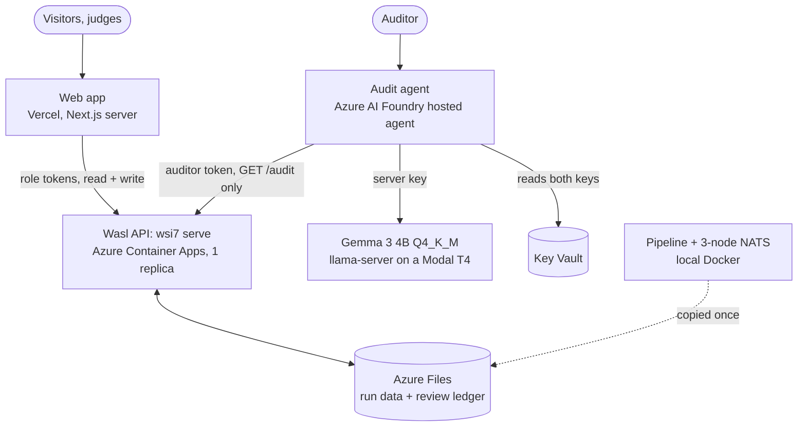
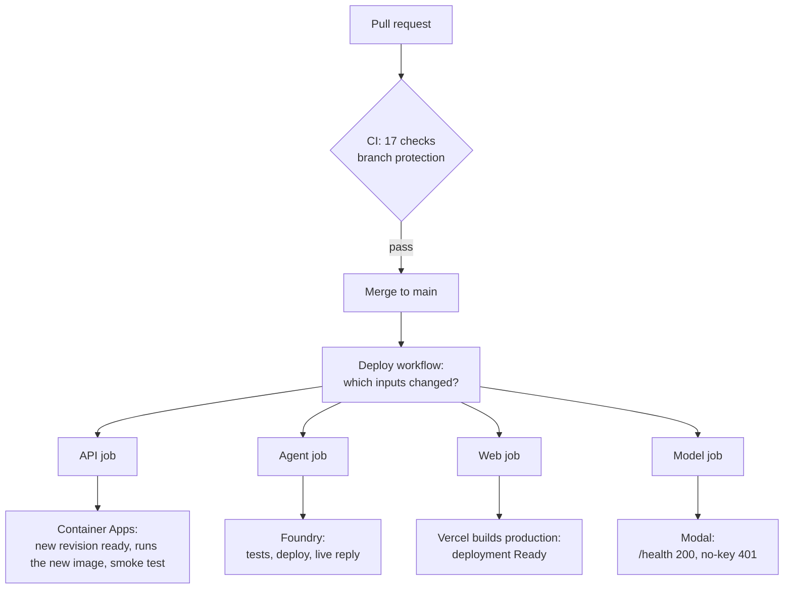

# Live deployment: links, architecture, CI/CD

The hosted Wasl demo, as running on 19 Nov 2026. This page is the map: what is live, where it runs, how the parts
connect, how code reaches them, and who holds which credential. Commands and evidence live in the documents it points
to. All data is synthetic.

## Links

| What | Link | Access |
|---|---|---|
| **Web app (the demo)** | https://wasl-topaz-mu.vercel.app | Public. Staff area at [`/app`](https://wasl-topaz-mu.vercel.app/app) |
| API health | https://wasl-api.blackground-3bcaad60.japaneast.azurecontainerapps.io/healthz | Public. Every `/api/*` route needs a role token ([`API.md`](API.md)) |
| Gemma 3 4B server health | https://kaiz404--wasl-gemma-serve.us-east.modal.run/health | Public. `/v1/*` needs the server key |
| Audit agent | [ai.azure.com](https://ai.azure.com), project `wasl-agents` (account `wasl-foundry-1608b4`), agent `wasl-audit-explainer` | Azure sign-in with access to `rg-wasl-demo` |
| Deploy runs | https://github.com/Mizore66/wasl-futurehealth/actions/workflows/deploy.yml | Repository access |
| Vercel project | https://vercel.com/kais-projects-42abda1c/wasl | Member of the Vercel team "Kai's projects" |
| Modal app | https://modal.com/apps/kaiz404/main/deployed/wasl-gemma | Member of the Modal workspace `kaiz404` |
| Azure resources | Azure portal, resource group `rg-wasl-demo` (`japaneast`) | Azure sign-in to the owning subscription |

## Architecture

**The model is small and local by design.** Wasl's language model is Gemma 3 4B as the quantized file
`gemma-3-4b-it-Q4_K_M.gguf`, the same file and `llama-server` flags the repository's reader uses. A hospital runs it on
its own machine, so patient text never reaches a cloud-hosted model. In the demo, Modal stands in for that machine and
only ever receives synthetic data. No frontier model is in any request path.

**Request paths.**
- **Web.** The browser talks only to Vercel. The Next.js server calls the API with role tokens held in Vercel's
  production settings ([`DEPLOY.md`, "Hosted frontend"](DEPLOY.md#hosted-frontend-vercel)), so no token reaches the
  browser. Coordinator and referral actions append to the hash-chained review ledger on Azure Files, which survives
  restarts. Reviewers sign in with their own personal tokens.
- **Agent.** Given a case id, the agent reads the auditor token and the Gemma key from Key Vault, makes one
  `GET /api/cases/{id}/audit`, and asks Gemma once for a plain-language explanation with a provenance line. It sends
  nothing to any write route ([`deploy/azure/agent/README.md`](../deploy/azure/agent/README.md)).

## What runs where

| Part | Platform and names | Deployed from | Status |
|---|---|---|---|
| Web app | Vercel project `wasl` (team `kais-projects-42abda1c`), Root Directory `web`, alias `wasl-topaz-mu.vercel.app` | `web/` | **built** |
| API | Container App `wasl-api` in environment `wasl-env-vnet` (VNet `wasl-vnet`); image from ACR `wasldemo8e952e` | root `Dockerfile` | **built** |
| Run data and ledger | Storage account `waslrun4f7f2e`, share `wasl-run`, mounted at `/var/lib/wasl` as UID 10001 | one local pipeline run, refreshed on 20 Nov 2026 (#256) | **built, local**: the pipeline did not run on Azure |
| Audit agent | Foundry account `wasl-foundry-1608b4`, project `wasl-agents`, agent `wasl-audit-explainer` | `deploy/azure/agent/` | **built, demo**: output is unvalidated prose |
| Gemma 3 4B | Modal app `wasl-gemma`, volume `wasl-gemma-weights`, secret `wasl-gemma-key`, one T4, scales to zero | `deploy/modal/` | **built** |
| Secrets | Key Vault `wasl-kv-59c0db`: `wasl-auditor-token`, `gemma-api-key` | `deploy/azure/README.md` | **built** |
| `gpt-4.1-mini` | Foundry deployment, unused since 18 Nov; kept on request | none | idle |
| Live Gemma for the Go readers, NATS and the pipeline on Azure, Entra sign-in | none | none | **designed** |

Measured, one sample each unless noted. The API served 2,148 cases. Gemma took 1.3 s warm and generated 50.6 tokens per
second; cold starts took 135 s after a fresh deploy and 68 s and 74 s after scaling to zero. One end-to-end agent
answer took 12 s. Evidence is in [`DEPLOY.md`, "Azure"](DEPLOY.md#azure) and
[`deploy/azure/decisions.tsv`](../deploy/azure/decisions.tsv).

### Regions

| Part | Region | Why there |
|---|---|---|
| Everything on Azure: API, Azure Files, Key Vault, registry, Foundry agent | `japaneast` (Tokyo) | The subscription allows only five Asian regions, and only `japaneast` and `koreacentral` offer both hosted agents and the model quota |
| Web app server functions | Vercel `hnd1` (Tokyo), set in [`web/vercel.json`](../web/vercel.json) | Next to the API, so a page's many API calls are same-city hops |
| Web app edge | Vercel's nearest edge to the visitor | Vercel routes it automatically |
| Gemma server | Modal US East | Modal's default. The agent calls it once per answer, so the extra distance adds roughly 0.15 s (estimate), far less than generation time or a cold start |

The functions ran in Vercel's default `iad1` (Washington, D.C.) until 20 Nov 2026. Moving them to `hnd1` cut median
time to first byte, three samples per page from Malaysia, from 3.33 to 1.32 s on `/app/today`, 3.56 to 1.50 s on
`/app/patients`, and 4.76 to 1.52 s on `/app/referrals`. Keep the functions in the API's region if either moves.

## CI/CD

- **CI** ([`CI.md`](CI.md)) runs on every pull request. Branch protection admits a merge only when "CI required"
  passes and the branch is up to date with `main`.
- **Deploy** ([`.github/workflows/deploy.yml`](../.github/workflows/deploy.yml)) runs on every push to `main` and
  deploys only the targets whose inputs changed. The path list is in the runbook's
  ["Continuous deployment"](../deploy/azure/README.md#continuous-deployment). Run it by hand from the Actions page,
  for `all` or a single target, to redeploy without a code change.
- **Proof.** All four jobs passed on GitHub on 18 Nov by manual dispatch (runs 44336690733 and 44346100602). The
  merges of #251 to #255 (19 and 20 Nov) each deployed the changed web app, and twice the API, from a push to
  `main` with no manual step.

## Identities and secrets

| Credential | Lives in | Used by | Renew |
|---|---|---|---|
| Azure deploy identity `wasl-github-deploy` | Federated credentials trusting `main` only; no stored secret | API and agent jobs | Never expires |
| GitHub variables `AZURE_CLIENT_ID`, `AZURE_TENANT_ID`, `AZURE_SUBSCRIPTION_ID`, `VERCEL_ORG_ID`, `VERCEL_PROJECT_ID` | Repository variables | Deploy workflow | Only if the resources change |
| `VERCEL_TOKEN`, scoped to "Kai's projects" | GitHub secret | Web job | **Expires 30 days after creation (about 18 Dec 2026)** |
| `MODAL_TOKEN_ID`, `MODAL_TOKEN_SECRET` | GitHub secrets | Model job | **Expires about 18 Dec 2026** |
| API role tokens (`WASL_API_TOKENS`) | Container Apps secret `wasl-api-tokens`; the five the web server reads are Vercel production variables; the auditor token is also in Key Vault | API, web, agent | Rotate all copies together ([`DEPLOY.md`](DEPLOY.md#hosted-frontend-vercel)) |
| Personal reviewer and clinician tokens | Outside the repository, with the person who deployed (Kai) | People signing in to review | Ask Kai |
| Gemma server key | Modal secret `wasl-gemma-key` and Key Vault `gemma-api-key` | Gemma server, agent | Change both together |

To renew the GitHub tokens, run `bash deploy/azure/ci_setup.sh` on a machine with `az`, `vercel link`, `gh` and the
Modal CLI. It checks a Vercel token before storing it and never prints a token.

## Before a live demo

1. Open the Gemma health link two minutes ahead, or keep one GPU warm for the session with
   `WASL_GEMMA_WARM=1 python -m modal deploy deploy/modal/gemma_server.py` (about USD 0.59 an hour). Afterwards,
   redeploy without the variable.
2. Remember that the web app writes to the shared synthetic ledger. Every visitor acts as the same coordinator, unit
   clinician and referrer, and their actions persist for every later visitor.
3. For the agent, ask it in the Foundry playground, or from `deploy/azure/`:
   `azd ai agent invoke wasl-audit-explainer "Explain the audit trail for ahs-mushrif/ServiceRequest/AHS-sr-1001"`.

## Known limits

- **The production alias is public by decision**, so judges can open it without an account. Every other Vercel
  deployment URL needs a team sign-in.
- **The run data is a fixed snapshot.** Nothing refreshes it, because a new pipeline run invalidates the review
  ledger. Refreshing is a deliberate manual step ([runbook](../deploy/azure/README.md), sections 1 and 2). The last
  refresh, on 20 Nov 2026, added preferred language and masked phone numbers and reset the ledger (#256).
- **No concurrent ledger write during a revision restart has been tested** on Azure Files.
- **The agent identity still holds two Foundry model roles** from its `gpt-4.1-mini` version, which it no longer
  needs.
- **Cost.** The always-on API replica is the main cost, roughly USD 1.5 to 2 a day (an estimate). It runs on an
  Azure for Students subscription with a spending cap. Teardown: `az group delete -n rg-wasl-demo`, then
  `python -m modal app stop wasl-gemma`.

## Where the detail lives

| Need | Read |
|---|---|
| Step-by-step commands to rebuild any part | [`deploy/azure/README.md`](../deploy/azure/README.md) |
| What was verified, with dates and run ids | [`DEPLOY.md`, "Azure"](DEPLOY.md#azure) |
| Every decision and its evidence | [`deploy/azure/decisions.tsv`](../deploy/azure/decisions.tsv) |
| The Gemma server | [`deploy/modal/gemma_server.py`](../deploy/modal/gemma_server.py) |
| The audit agent | [`deploy/azure/agent/README.md`](../deploy/azure/agent/README.md) |
| The API contract | [`API.md`](API.md) |
