# Wasl usability audit

Audit date: 17–18 November 2026 (UTC). Subject: the Wasl web app (`web/`) in **live mode** on a 7-programme synthetic run. Purpose: describe the screens a demo video will show, what happens behind each action, and how the journey reads to a first-time evaluator, then record findings against Nielsen's heuristics, WCAG 2.2 AA, clinical-safety UX and task-flow metrics.

All data is synthetic. Every write described here went to the synthetic demo ledger (`<run>/api_reviews.ndjson`).

## Contents

- [0. How this was observed](#0-how-this-was-observed)
- [1. Journeys chosen for the demo video](#1-journeys-chosen-for-the-demo-video)
- [Version A — Team walkthrough](#version-a--team-walkthrough)
- [Version B — Judge's-eye view](#version-b--judges-eye-view)
- [3. Findings by framework](#3-findings-by-framework)
- [4. Known live-mode issues observed](#4-known-live-mode-issues-observed)
- [5. What could not be observed live](#5-what-could-not-be-observed-live)

---

## 0. How this was observed

| Item | Detail |
|---|---|
| Frontend | `http://localhost:3001`, Next.js 16.4.5 **dev server** (`next dev`), live mode (`WASL_API_URL=http://127.0.0.1:8088`) |
| API | `wsi7 serve` on `127.0.0.1:8088`, run `v7strict-cached-fhir-lung-dr-breast-ldct-ifhas-drnext-lungsurv-xreflink-showcase4`, policy `v7strict` with `-drnext -lungsurv -xreflink` |
| Credentials in the Next server | coordinator, clinician, reviewer, web_reviewer, auditor. **No referrer tokens; no `clinician_2`/`reviewer_2`/`reviewer_3` in the web server** (they exist in the API process only) |
| Browser | Playwright 1.64.1, Chromium, headless. Desktop 1280×800; phone 390×844 with `isMobile` and touch |
| Automated accessibility | `@axe-core/playwright` (already in `web/node_modules`), tags `wcag2a, wcag2aa, wcag21a, wcag21aa, wcag22aa`, run on 20 page states |
| Manual accessibility | keyboard tab-through on `/app` and `/app/today` (focus order, focus indicator style), on-screen target-size measurement of every visible interactive element, `lang`/`dir` checks, heading outline, landmark count |
| Patient link | Minted with `bin/wsi7 patient-link -run <run> -case ahs-mushrif/ServiceRequest/AHS-sr-1046 -ttl 4h` (`WASL_SYNTHETIC_DATA_ONLY=1`); opened through `/patient/access?link=…`. The raw link is not reproduced here |
| Scripts | `~/wasl-ml-data/usability/scripts/*.mjs` (survey, phone, coordinator, review, audit/referrer checks); raw JSON results alongside |

**Writes made to the synthetic ledger to observe flows** (case `AHS-sr-1046` unless stated):

1. Patient link: `teach_back_answered` (wrong answer), `teach_back_completed` (second attempt), `contact_permission_changed` (granted).
2. Coordinator on Today: `contact_outcome` reached, then `contact_outcome` appointment_agreed.
3. Coordinator on the case page: `teachback_callback` `understood_on_call`.
4. Reviewer on the review desk, case `AHS-sr-897`: identity question claim, then release. No read was submitted.
5. Referrer "Acknowledge" on `/app/referrals/returned` was attempted twice and refused by the server (no referrer credential); nothing was appended.

**Caveat on timings.** The frontend runs in `next dev`, which compiles routes on demand. Page-load times below (for example 11.5 s for Today, 26 s for Referrals, 14 s for a case record) are dev-mode figures and are reported only as observations, not as production performance. The Next.js dev indicator (the round "N" badge, bottom left) appears in screenshots and partly covers the sidebar's "Synthetic data · demo" chip; it is absent from a production build.

---

## 1. Journeys chosen for the demo video

The feature map lists 20+ routes. A 2–3 minute video can carry one patient's loop across four roles. The chosen journeys share **one case** where possible (`AHS-sr-1046`, CRC, Al Mushrif), so the viewer follows a single patient through every hand-off.

| # | Journey | Role (persona) | Why it is in the video |
|---|---|---|---|
| J1 | Programme KPI → "Open today's list" | Programme director (Dr Salama Al Tamimi) | States the problem in one number: 11.3% reported by Emirates ID only vs 30.7% measured by Wasl vs 31.9% true |
| J2 | Patient phone: notice → teach-back fail → callback receipt → retry → SMS permission → book preference | Patient | Shows the closed-loop communication check and the first role hand-off (patient → nurse) |
| J3 | Today: the callback surfaces → Log call → Reached → Appointment agreed; case page "understood on the call" | Nurse coordinator (Hessa Al Ali) | Shows the hand-off arriving, the append-only call log and the loop closing |
| J4 | Review desk: independent double review of a held identity/evidence question, with the source records | Reviewer / clinician (Dr Omar Al Kaabi persona) | Shows that uncertainty goes to two different people, not to automation |
| J5 | Audit trail and redacted export | Auditor | Shows that every step above is verifiable |

Journeys left out of the video, with the reason: Recovery (simulated capacity, a separate story), Referrals and Returned referrals (the referrer write path is not configured locally, see §4), People (useful but adds a screen without a new role), Pipeline replay and Results (frozen or replayed data; better on a slide), Agent review (experimental snapshot).

### Proposed shot list (target 2:45)

| Time | Screen | On screen action | Narration point | Screenshot |
|---|---|---|---|---|
| 0:00–0:20 | `/app` Programme | Hover the three KPI bars; point at 11.3% vs 30.7% vs 31.9% | "The official 31-day rate is under-reported because records do not join on Emirates ID." | [01](usability/01-programme-kpi.png) |
| 0:20–0:30 | `/app` → Today | Click "Open today's list" | "Wasl turns the gap into a worklist." | [02](usability/02-today-worklist.png) |
| 0:30–1:05 | Patient phone `/patient/notice` → `/patient/check` | Read notice; answer "Another blood test in a month"; show "Let us explain it another way" and the callback receipt; answer again correctly; allow SMS | "We check she understood, and if not, a nurse is booked to call her." | [08](usability/08-phone-notice.png), [09](usability/09-phone-teachback-question.png), [10](usability/10-phone-teachback-callback.png) |
| 1:05–1:15 | `/patient/book` | Show proposed date and preparation checklist | "She states a preference; booking stays with the coordinator." | [11](usability/11-phone-book.png) |
| 1:15–1:45 | Today, search `AHS-sr-1046` | Row reads "Teach-back failed · nurse callback due …"; Log call → Reached → Appointment agreed; patient moves to Waiting | "The failed check lands on the nurse's list. Every outcome is written to an append-only ledger." | [03](usability/03-today-teachback-callback.png), [04](usability/04-today-reached-what-next.png), [05](usability/05-today-appointment-agreed.png) |
| 1:45–1:55 | Case page, Teach-back nurse callbacks | "Record: understood on the call" | "The callback task is closed explicitly, by a person." | [07](usability/07-case-callback-resolved.png) |
| 1:55–2:25 | `/app/review` → review desk `AHS-sr-897` | Queue shows "Held: the two readers could not settle…"; sign in; claim; show identifier comparison and answer form; (optionally) a second token shows the blinded r2 | "When the machine is unsure, two different people answer separately; neither sees the other first." | [13](usability/13-review-queue.png), [15](usability/15-review-desk-claimed.png) |
| 2:25–2:45 | Case → Audit trail → Download export | Show "Decision signatures 9 of 9 match", review history with the patient and coordinator events from this session, export hashes | "Every step above is in a hash chain an auditor can check and export." | [16](usability/16-audit-trail.png), [17](usability/17-audit-export.png) |

Recording notes that follow from the observations below: record from a production build (`next build && next start`) to remove the dev indicator and the long compile waits; pre-warm each route once; mint a fresh patient link per take (each link carries the patient's teach-back state, so a second take on the same case starts at "Thank you").

---

# Version A — Team walkthrough

Per screen: what the user sees and can do; what the backend does (endpoint, handler, append vs canonical change, RBAC/independence/consent rules); built vs simulated vs designed; intended next step. Line references are to `origin/main` at `0ab7b0fc`.

## A1. Programme (`/app`) — Programme director

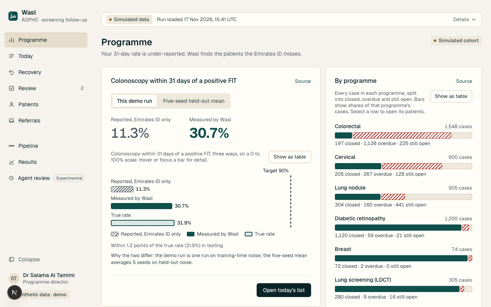

| Aspect | Detail |
|---|---|
| Sees | "Your 31-day rate is under-reported. Wasl finds the patients the Emirates ID misses." KPI card "Colonoscopy within 31 days of a positive FIT" with a toggle "This demo run / Five-seed held-out mean": Reported, Emirates ID only **11.3%**; Measured by Wasl **30.7%**; True rate **31.9%**; target line 90%. "By programme" bar chart (Colorectal 1,548 cases; 197 closed · 1,126 overdue · 225 still open, and so on for six other programmes). "Where patients stall", "Booking capacity" (labelled simulated), "By provider", "Safety". |
| Can do | Toggle run vs five-seed mean; "Show as table" on each chart (accessible alternative); "Source" disclosures; select a programme row to open its patients; **Open today's list**. |
| Backend | `GET /api/dashboard` → `getDashboard` (`pipeline/api.go:649-687`). Read-only. Counts active cases by state, drop-off, review and programme, copies report metrics, adds SLA/provider/origin tables and the simulated `capacity()`. KPI figures also come from frozen `results.json`. |
| Status | Built (synthetic). Labels: "Simulated cohort", "Simulated decision support" on capacity. |
| Next step | "Open today's list" → `/app/today` (observed: lands on `/app/today`, default CRC at Al Mushrif). |

## A2. Patient phone — notice (`/patient/notice`)

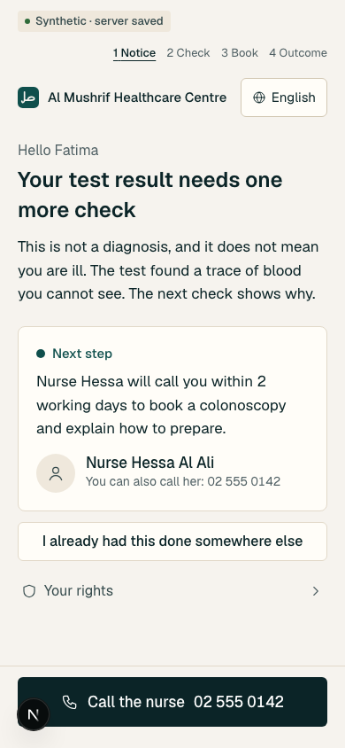

| Aspect | Detail |
|---|---|
| Entry | Staff runs `wsi7 patient-link`; the patient opens `/patient/access?link=…`. The route verifies the link with the Go API, sets `__Host-wasl_patient_link` (HttpOnly, Secure, SameSite=Lax), and redirects 303 to `/patient/notice` (`web/app/patient/access/route.ts`). Observed: 200 after redirect; token removed from the visible URL. |
| Sees | "Synthetic · server saved"; step tabs 1 Notice · 2 Check · 3 Book · 4 Outcome; provider name; language button (English). "Hello Fatima. Your test result needs one more check. This is not a diagnosis, and it does not mean you are ill…". Next step: "Nurse Hessa will call you within 2 working days to book a colonoscopy…". Nurse name and number. "I already had this done somewhere else". "Your rights". Sticky "Call the nurse 02 555 0142". |
| Can do | Report completed elsewhere (form); open Your rights (request an explanation, contest a decision, simulated one-time code); move to Check. |
| Backend | `GET /api/patient/journey` (`patientJourney`, `pipeline/api_patient.go:421`) via the Next proxy (`lib/api/patient-proxy.ts`, cookie → bearer, `no-store`, 8 KiB limit). Returns `wasl-patient-journey/1`: patient-only head, teach-back, contact permission, offers, expiry. No case ID, evidence or audit data. Completed-elsewhere: `POST /api/patient/completed-elsewhere` appends `patient_completion_report`, suspends chase, opens a coordinator retrieval task due in 14 days, max 2 per link. |
| Status | Built. Message delivery is simulated (nothing is sent). Only English is served to patients; other dictionaries are gated to the internal translation-review preview. |
| Next step | Check. |

## A3. Patient phone — teach-back (`/patient/check`)

| Question | Wrong answer → callback receipt | Correct answer → SMS permission |
|---|---|---|
| 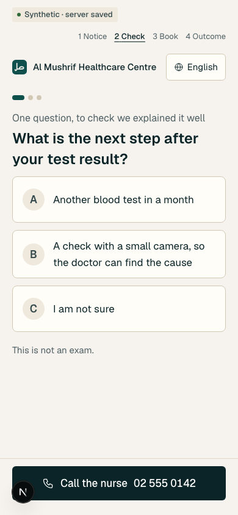 | 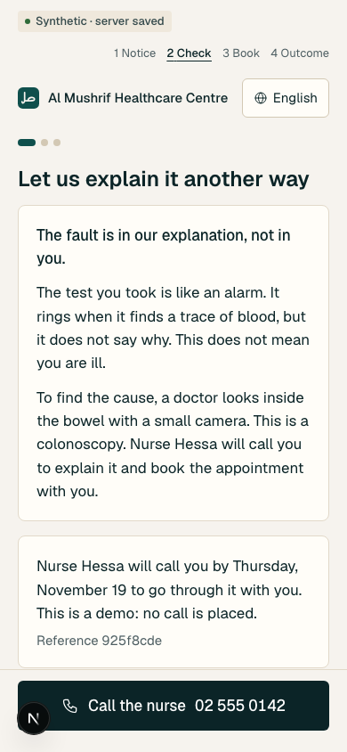 | (text below) |

| Aspect | Detail |
|---|---|
| Sees | "One question, to check we explained it well. What is the next step after your test result?" Answers A "Another blood test in a month", B "A check with a small camera, so the doctor can find the cause", C "I am not sure". "This is not an exam." |
| Wrong answer (observed: A) | "Let us explain it another way. The fault is in our explanation, not in you." Plain-language explanation of colonoscopy. Receipt: "Nurse Hessa will call you by Thursday, November 19 to go through it with you. This is a demo: no call is placed. Reference 925f8cde". Button "Ask me again". Status line "Saved." |
| Correct answer (observed: B on retry) | "Well done, that is right. May we send you reminders by SMS? … saying no will not delay your appointment." Buttons "Allow messages" / "Not now". After Allow: "Thank you, Fatima … Your permission for SMS reminders is recorded. No SMS has been sent." and "Stop text messages". |
| Backend | `POST /api/patient/journey` with `kind` `teach_back_answered` (wrong) or `teach_back_completed` (right), `expected_head`, UUID `request_id`. A `misunderstood`/`needs_human` answer opens a `teach_back_callback` task owned by `coordinator`, due in **2 working days** (`docs/API-PATIENT-REQUESTS.md` table). A second failed attempt while a callback is open opens no second task. `contact_permission_changed` updates the demo `api_contact` guard only. All are appended as `patient_journey` events; canonical consent, decisions, signatures and outreach are unchanged. The client advances only after the server confirms (`check-flow.tsx:66-72`), and refetches on 409 (`use-patient-journey.ts`). |
| Status | Built. The callback call itself is simulated ("no call is placed"). |
| Hand-off | Patient → coordinator: the open task appears on Today (A5). A correct retry does **not** close the callback task; only a coordinator or clinician consultation outcome does (observed, and by design per `docs/API-PATIENT-REQUESTS.md:35`). |
| Next step | Book. |

## A4. Patient phone — book and outcome (`/patient/book`, `/patient/outcome`)

| Book | Outcome |
|---|---|
| 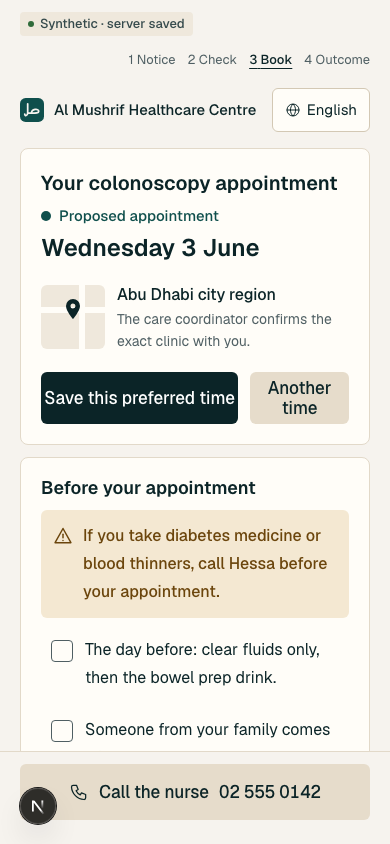 | 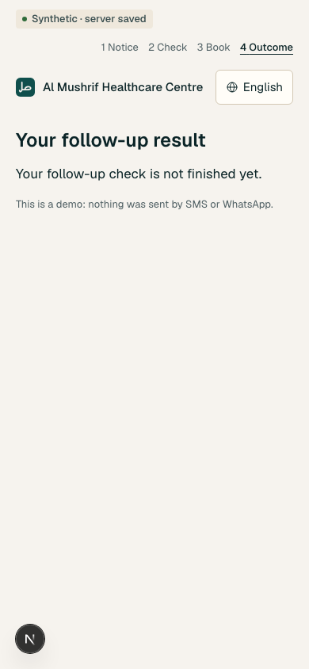 |

| Aspect | Detail |
|---|---|
| Book: sees | "Your colonoscopy appointment · Proposed appointment · Wednesday 3 June · Abu Dhabi city region · The care coordinator confirms the exact clinic with you." Buttons "Save this preferred time" / "Another time". "Before your appointment": warning about diabetes medicine or blood thinners; checklist "The day before: clear fluids only, then the bowel prep drink" and "Someone from your family comes with you and takes you home" (`role="checkbox"`). |
| Book: backend | Offers come from `pipeline/api_patient_offers.go`: for CRC, the case's own colonoscopy candidates from `booking.json`; `starts_at` is the **run-clock date** (no time of day). `slot_selected` and `preparation_changed` append `patient_journey` events; slot wording is a preference for coordinator review, not a reservation. |
| Outcome: sees | "Your follow-up result. Your follow-up check is not finished yet. This is a demo: nothing was sent by SMS or WhatsApp." |
| Outcome: backend | `GET /api/patient/outcome` (`api_outcome_handoff.go:375`). After closure, clinician approval and coordinator release (API-only), the patient verifies a code and acknowledges. |
| Status | Booking preference: built, offers simulated. Outcome hand-off: built (API); the staff approve/release UI is not built (`docs/API-OUTCOME-HANDOFF.md:81-84`). |

## A5. Today (`/app/today`) — Nurse coordinator

| Default queue | Teach-back callback surfaced | After Reached | After Appointment agreed |
|---|---|---|---|
| 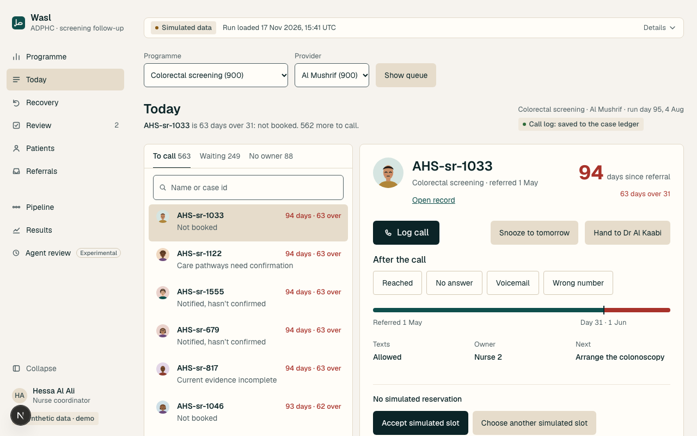 | 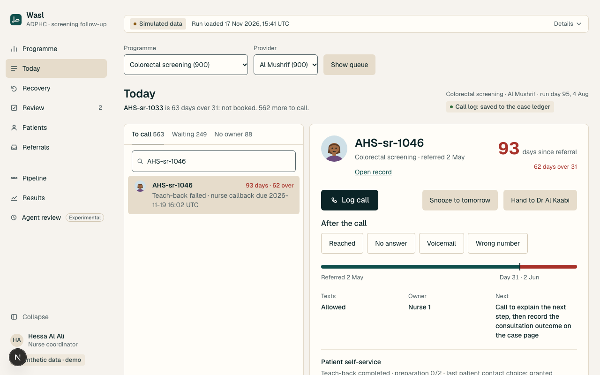 | 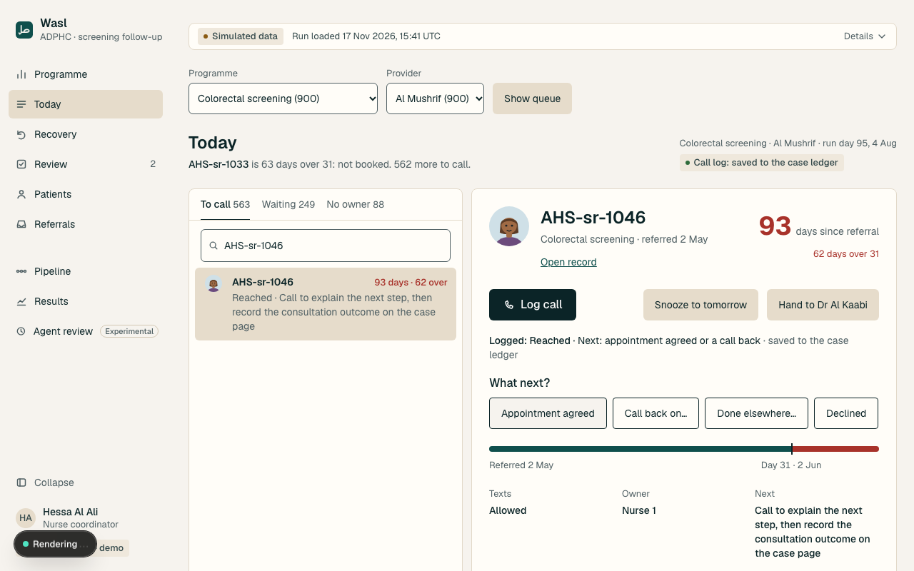 | 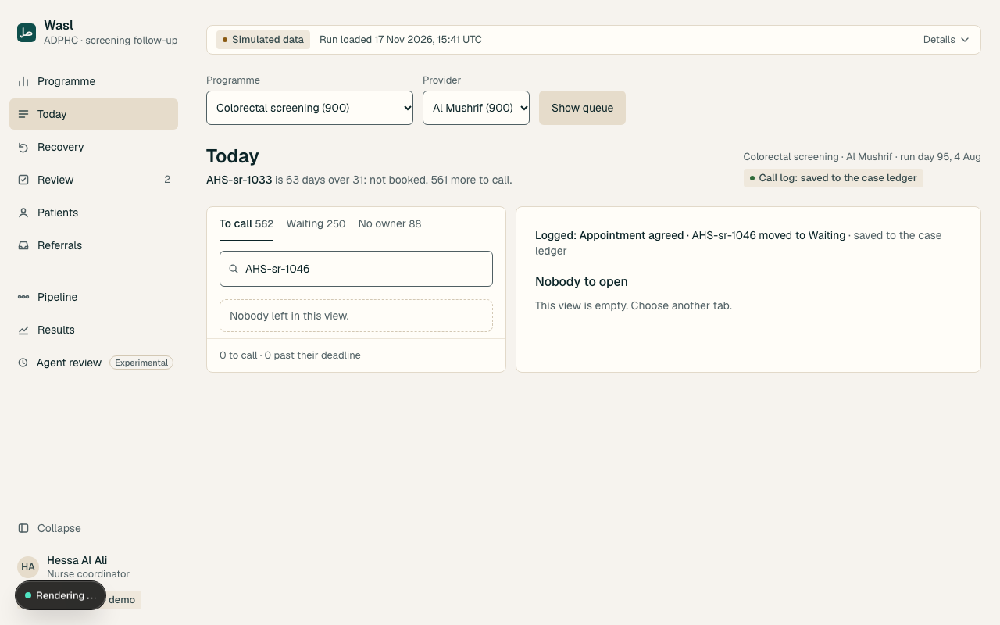 |

| Aspect | Detail |
|---|---|
| Sees | Programme and provider selects with counts (Colorectal screening 900; Al Mushrif 900) and "Show queue". Heading "Today", summary "AHS-sr-1033 is 63 days over 31: not booked. 562 more to call." Scope line "Colorectal screening · Al Mushrif · run day 95, 4 Aug". Chip "Call log: saved to the case ledger". Tabs **To call 563 · Waiting 249 · No owner 88**, search, rows (case ID, days since referral, days over 31, status). Open-patient pane: days counter, Log call, Snooze to tomorrow, Hand to Dr Al Kaabi, "After the call" chips, a referral-to-deadline bar, Texts / Owner / Next, Patient self-service summary, simulated booking ("Accept simulated slot", "Choose another simulated slot"), Contacts. |
| Hand-off arriving | Searching `AHS-sr-1046` after the phone flow: row status "**Teach-back failed · nurse callback due 2026-11-19 16:02 UTC**" (`worklist/model.ts:255-256`); pane Next: "Call to explain the next step, then record the consultation outcome on the case page"; Patient self-service: "Teach-back completed · preparation 0/2 · last patient contact choice: granted"; Contacts: "Patient teach-back not yet understood · nurse callback". |
| Can do | Log call (opens call logging; no dialler is connected, `today-board.tsx:686-703`) → **Reached / No answer / Voicemail / Wrong number**; after Reached → **Appointment agreed / Call back on… / Done elsewhere… / Declined**; call-back date chips; retrieval-outcome chips when a done-elsewhere report is pending; Snooze; Take this patient / Hand to Dr Al Kaabi; staff communication form (initial notification and receipt acknowledgement); simulated slot. |
| Observed sequence | Log call → Reached: toast "Logged: Reached · Next: appointment agreed or a call back · saved to the case ledger"; chip set changes to "What next?". Appointment agreed: "Logged: Appointment agreed · AHS-sr-1046 moved to Waiting · saved to the case ledger"; To call 563 → 562, Waiting 249 → 250; search view now empty ("Nobody left in this view."). |
| Backend | Server action `recordAction` → `postAction` → `POST /api/cases/{id}/actions` with the **coordinator token** and `expected_head` (`today/actions.ts:22-36`). Handler `caseAction` (`api.go:2118-2290`): RBAC `coordinate_case`; strict body; `expected_head` 409 on conflict; `contact_outcome` requires canonical consent `granted` and no denial/opt-out (409 `consent`); communication preconditions, booking readiness and slot conflicts. Appends a `coordinator_action` event and folds it into `api_overlay`. Response: "recorded … as overlay metadata; decisions and signatures are unchanged and nothing was dispatched". The UI shows an outcome only after a 201. Live mode has **no Undo** ("The ledger is append-only, so there is no Undo", `today-board.tsx:35`); fixtures mode keeps a browser-side Undo. |
| Status | Built (call logging, owner changes, communication records). Booking: simulated reservation events. Dialler and messages: not connected. |
| Next step | Resolve the callback on the case page (A6); booking via the simulated slot; or hand to the clinician. |

## A6. Case record (`/app/patients/[id]`) — callback resolution

| Header and timeline | Callback card after "understood on the call" |
|---|---|
| 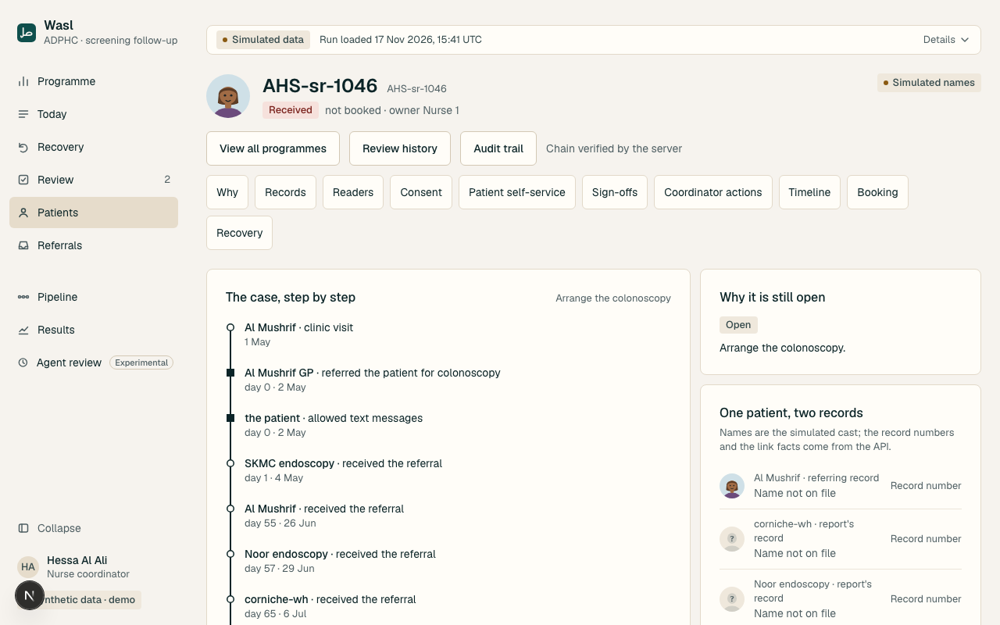 | 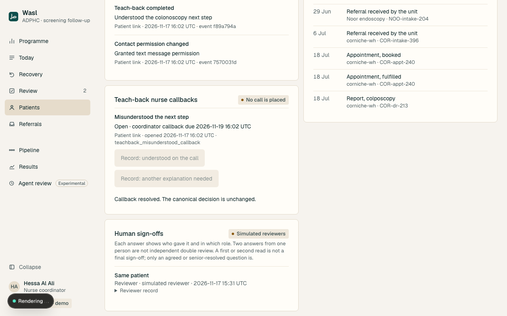 |

| Aspect | Detail |
|---|---|
| Sees | Header: case ID as the title (no cast name for live cases), stage pill, status words and owner; "Simulated names" chip; "View all programmes", "Review history", "Audit trail", "Chain verified by the server"; in-page nav chips (Why, Records, Readers, Consent, Patient self-service, Sign-offs, Coordinator actions, Timeline, Booking, Recovery). Cards: "The case, step by step", "Why it is still open", "One patient, two records", Audit, Consent and messages, Patient self-service timeline (each patient event with time and short event ID), **Teach-back nurse callbacks**, Human sign-offs, Coordinator actions (the two contact outcomes from A5, actor `smoke-coordinator · Coordinator`), Booking, Timeline. |
| Can do | "Record: understood on the call" / "Record: another explanation needed"; consent actions; patient-contest resolution (senior clinician session only); link out to review, audit and People. |
| Observed | After "Record: understood on the call": status "Callback resolved. The canonical decision is unchanged." The API showed the task `status: resolved, resolved_by: smoke-coordinator` immediately. At the 3.5 s screenshot the list item still read "Open · coordinator callback due …" with both buttons disabled while the page re-rendered (server action calls `revalidatePath`, `patients/[id]/actions.ts:69-71`). |
| Backend | `recordTeachBackCallback` → `POST /api/cases/{id}/teach-back-callback` → `caseTeachBackCallback` (`api_teachback.go:281`). Coordinator or clinician. `understood_on_call` resolves the task and clears the served escalation; `another_explanation` keeps it open. Appended; canonical decision unchanged. |
| Status | Built. "No call is placed" label on the card. |
| Next step | Booking (simulated) or clinician hand-off; for audit, "Audit trail". |

## A7. Review queue and review desk (`/app/review`, `/app/review/[id]`)

| Queue | Desk, clinician token (identity question) | Desk, reviewer token after claim |
|---|---|---|
| 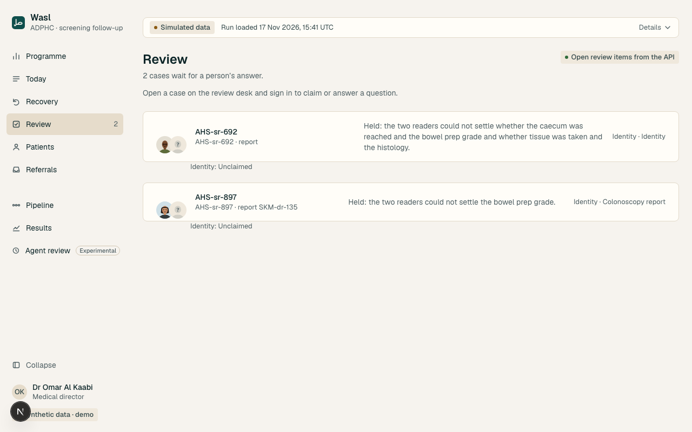 | 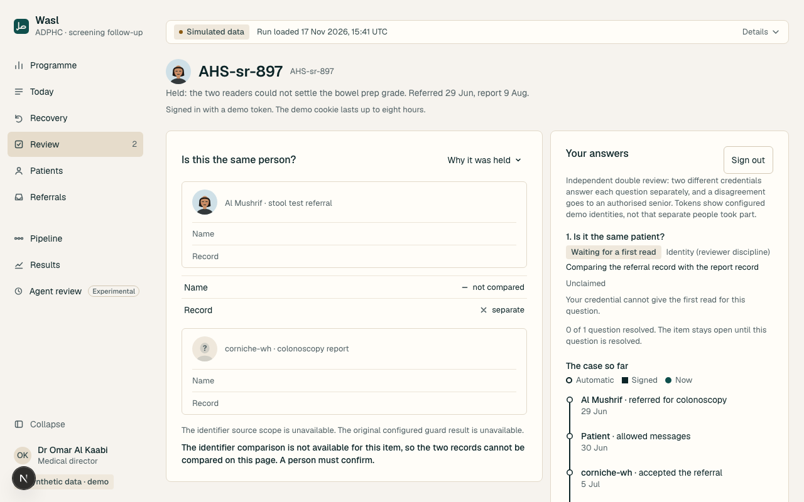 | 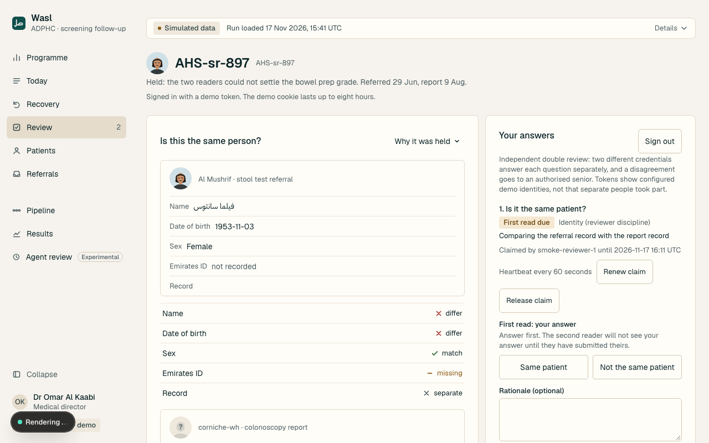 |

| Aspect | Detail |
|---|---|
| Queue sees | "2 cases wait for a person's answer." Chip "Open review items from the API". Rows: `AHS-sr-692` "Held: the two readers could not settle whether the caecum was reached and the bowel prep grade and whether tissue was taken and the histology." (Identity · Identity); `AHS-sr-897` "Held: the two readers could not settle the bowel prep grade." (Identity · Colonoscopy report); "Identity: Unclaimed" under each. |
| Desk, signed out | "Sign in to review. Enter the review token assigned to you… A token proves a configured demo identity, not that a separate person is present." Password-type token field. (OIDC mode shows only "Sign in with OIDC".) |
| Desk, clinician token | "1. Is it the same patient? Waiting for a first read · Identity (reviewer discipline) · Unclaimed · **Your credential cannot give the first read for this question.**" Identifier comparison withheld: "The identifier comparison is not available for this item…". |
| Desk, reviewer token | "First read due · Unclaimed · **Claim first read**". After claim: "Claimed by smoke-reviewer-1 until 2026-11-17 16:11 UTC · Heartbeat every 60 seconds · Renew claim · Release claim". "First read: your answer. Answer first. The second reader will not see your answer until they have submitted theirs." Radios **Same patient / Not the same patient**, "Rationale (optional)", "Submit first read". Left card "Is this the same person?" now shows both records' identifiers: Name فيلما سانتوس vs Vilma Santos (**differ**), Date of birth 1953-11-03 vs 1952-11-03 (**differ**), Sex match, Emirates ID missing, Record separate. Status: "Identity claim claim recorded. The current server state is shown." |
| Backend | Queue: `GET /api/cases?review=open` then `GET /api/cases/{id}` (`caseDetail`, `api.go:924`) with the viewer's token; r1 is blinded per viewer. Sign-in: server action sets `wasl_review_token` (HttpOnly; Secure; SameSite=Strict), or OIDC + PKCE. Claim: `POST /api/cases/{id}/review/claim` (`caseReviewClaim`), 5-minute lease, 60 s heartbeat (`review-desk.tsx:352-361`). Answer: `POST /api/cases/{id}/review` (`caseReview`, `api.go:959`): RBAC per decision (link = reviewer, evidence = clinician); evidence decision with missing/ambiguous/unreadable source → 409; r2 must be a different actor; disagreement opens r3 for a senior distinct from both readers; every response `canonical_unchanged: true`. Source report: `GET /api/cases/{id}/review/source?item=` (`api_review_source.go:105`) re-reads the FHIR log by pointer and hash. |
| Status | Built (synthetic reviewers in the run; API reviews are live). Live source-system retrieval is designed (`docs/API.md:378`). |
| Hand-offs | r1 → r2 (different credential) → r3 senior on disagreement. Undo/contest on history requires a different actor; resolver differs from both (`api_undo.go:477`). |
| Next step | After agreement, case continues; history appears on the Audit trail. |

## A8. Audit trail and export (`/app/patients/[id]/audit`)

| Audit trail | Export |
|---|---|
| 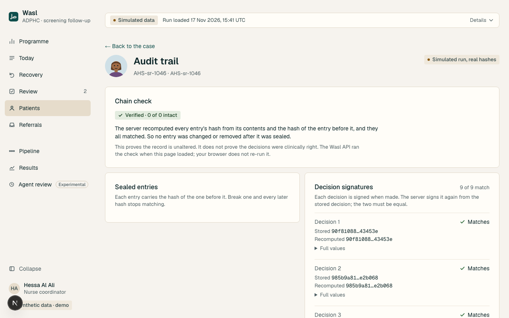 | 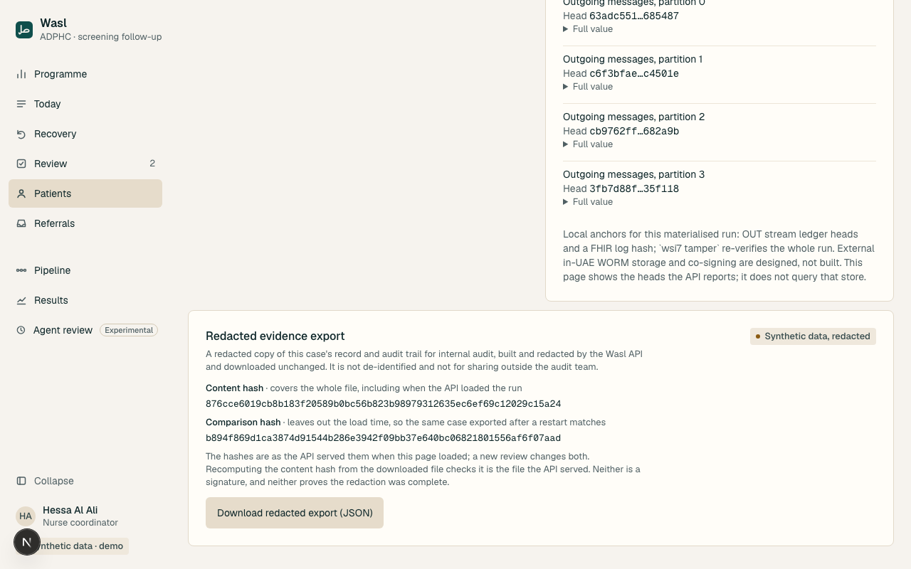 |

| Aspect | Detail |
|---|---|
| Sees | "← Back to the case", "Audit trail", "Simulated run, real hashes". **Chain check**: "Verified · 0 of 0 intact" for `AHS-sr-1046`, with "The server recomputed every entry's hash… This proves the record is unaltered. It does not prove the decisions were clinically right." **Sealed entries** (empty for this case). **Decision signatures** "9 of 9 match" with stored vs recomputed hashes and "Full values" disclosures. **Review history** "Demo actions, not clinical sign-offs", listing this session's patient-link and coordinator events with hashes ("Starts the log genesis · Hash 925f8cde…"). Anchors. **Redacted evidence export** with content hash and comparison hash, and "Download redacted export (JSON)". |
| Backend | `caseAudit` (`api.go:935`) with the auditor credential: redacted chain, `chain_verified`, decision signatures (stored vs recomputed), anchors. Export: Next route `GET /app/patients/[id]/audit/export` streams `GET /api/cases/{id}/export` (`caseExportRoute`, `api_export.go:1063`), auditor-only, `wasl-case-export/1` with `content_sha256`; refuses an export that would reveal a concealed initial read. Observed: 200, `application/json`, `attachment; filename="wasl-synthetic-redacted-export_ahs-mushrif_ServiceRequest_AHS-sr-1046.json"`, 104,930 bytes. |
| Status | Built; read-only. |

## A9. Task-flow analysis per role

### Programme director

| Entry | Steps | Decision points | Exit | Hand-off |
|---|---|---|---|---|
| Sidebar "Programme" (default for `/app`) | Read KPI (0 clicks) → optional toggle (1) → "Open today's list" (1) | Which programme/provider to drill into | Today, or a programme's Patients list | To the coordinator's worklist (navigation only; no assignment is recorded) |

### Patient

| Entry | Steps | Decision points | Exit | Hand-off |
|---|---|---|---|---|
| Link → 303 → Notice | Notice (read) → Check (1 tap per answer; observed 2 answers) → SMS permission (1) → Book (1 save + up to 2 checklist taps) → Outcome (read) | Answer; allow/decline SMS; accept or change date; report done elsewhere; rights request | "Thank you" screen; Outcome not finished | Wrong answer → coordinator callback (2 working days). Done elsewhere → coordinator retrieval (14 days). Contest → senior clinician (5 working days) + closure hold |

Observed: 5 taps from Notice to a saved SMS choice including one failed and one correct answer; 7 screens including the explanation.

### Nurse coordinator

| Entry | Steps (observed) | Decision points | Exit | Hand-offs |
|---|---|---|---|---|
| Programme "Open today's list" or sidebar Today | Select patient (search or list, 1–2) → Log call (1) → Reached (1) → Appointment agreed (1) = **4 clicks** after selection; then open record (1) → scroll to Teach-back nurse callbacks → "Record: understood on the call" (1) = **2 more clicks + a page change** | Outcome of the call; follow-up type; whether to book, snooze, take or hand off | Patient moves to Waiting; callback resolved | To clinician ("Hand to Dr Al Kaabi" sets owner; a declined patient owes a clinician disposition); from patient (callback, done-elsewhere); to recovery (simulated) |

Context switches for the callback task: Today (sees the task) → case record (resolves it) → back to Today. The case page took about 14 s to load in dev mode.

### Reviewer / clinician

| Entry | Steps | Decision points | Exit | Hand-off |
|---|---|---|---|---|
| Review queue (sidebar badge "2") | Open case (1) → sign in: paste token + submit (2) → Claim (1) → choose answer (1) → optional rationale → Submit (1) = **6 interactions** for r1 | Same patient / not the same; evidence labels per programme | "Waiting for the second read" or resolved | r1 → r2 by a different credential; disagreement → r3 senior |

Observed constraint: the identity question accepts only the reviewer discipline. A clinician token sees the item but "cannot give the first read". On the live run both open items lead with an identity question, so the evidence question (clinician, with the source report) was not reachable without first resolving identity through two reviewer credentials.

### Auditor

| Entry | Steps | Exit |
|---|---|---|
| Patients → case → "Audit trail" (or "Review history") | Read chain check, signatures, history (0–3 disclosures) → Download export (1) | JSON file with matching content hash |

---

# Version B — Judge's-eye view

This version follows the same journey as a first-time evaluator watching the video or clicking through the deployed demo. It records what they can understand from each screen alone, what they need to be told, and where labels need context.

## B1. Programme

**What they see first.** A large "11.3%" next to "30.7%", a third "True rate 31.9%", and a dashed "Target 90%". The subtitle states the claim directly: the official number is under-reported because the Emirates ID misses patients.

**What they understand.** The headline is clear without narration: Wasl's measurement is close to the truth and the Emirates ID-only figure is not. "Show as table" makes the numbers checkable.

**What they need to know.** That 30.7% is a measurement, not an improvement: the patients were already seen; Wasl finds the records. That the target is far above all three bars (the gap to 90% is a care-delivery problem, which Today addresses). "This demo run" vs "Five-seed held-out mean" is a statistics distinction a non-technical judge may not parse; the explanatory sentence ("the demo run is one run on training-time noise…") sits below the chart.

**Status labels.** "Simulated data", "Simulated cohort" and "Simulated decision support" appear as small chips. They are consistent and visible, which supports trust; their meaning (synthetic patients, real code) benefits from one sentence of narration.

## B2. Patient phone

**What they see.** A plain, reassuring notice ("This is not a diagnosis") with a named nurse and a phone number, then a three-option question. A wrong answer produces a kinder re-explanation ("The fault is in our explanation, not in you.") and a dated receipt for a nurse call.

**What they understand.** The teach-back concept is legible without prior knowledge. The callback receipt with a reference number reads as a commitment.

**What they need to know.** That the wrong answer created a task on a staff worklist (shown next in the video); without that cut, the receipt reads as a message only. That "This is a demo: no call is placed" is deliberate honesty labelling, not an error.

**Where context is needed.**
- **Two clocks.** The callback is "by Thursday, November 19" (today's wall clock), while the proposed appointment is "Wednesday 3 June" (the run clock; Today's scope reads "run day 95, 4 Aug"). On one phone, a June appointment after a November callback can read as inconsistent. The underlying design is documented (`docs/API.md`: offers use the run-clock date), but the screen does not say so.
- **Patient name.** The phone greets "Fatima"; the staff screens for the same case show only `AHS-sr-1046` and "Name not on file". A judge comparing the two may not connect them.
- **Outcome step.** "Your follow-up check is not finished yet" is accurate for an open case, but it leaves the fourth step without visible content in the demo.

## B3. Today

**What they see.** A focused work list: who to call, how late they are (red "63 over"), one large "Log call" button and outcome chips. Counts on the tabs drop as patients are handled.

**What they understand.** The coordinator's task is obvious. Outcome chips with immediate "Logged … saved to the case ledger" confirmation communicate an audited workflow.

**What they need to know.** That "Log call" does not dial (labelled in the code, not on screen). That the failed teach-back from the phone is the "Teach-back failed · nurse callback due 2026-11-19 16:02 UTC" row. That "Appointment agreed" does not book anything; booking is the simulated slot below.

**Where context is needed.**
- The row date format (`2026-11-19 16:02 UTC`) differs from the phone's "Thursday, November 19", for the same due time.
- The pane can show "Teach-back completed" and "Patient teach-back not yet understood · nurse callback" at the same time (completed on retry; callback still open by design). Without narration this reads as contradictory.
- After "Appointment agreed" the patient leaves To call, while the callback task is still open on the case page. The worklist status that announced the callback is no longer visible in that view.
- Case IDs (`AHS-sr-1033`) appear where a name would be; avatars without a cast entry show a "?" glyph.

## B4. Case record

**What they see.** A long page with a step-by-step timeline, many cards and an in-page nav of ten chips.

**What they understand.** The append-only story: patient events, coordinator actions with actor and role, and the callback resolution "The canonical decision is unchanged."

**Where context is needed.**
- For `AHS-sr-1046` the timeline shows "corniche-wh · colonoscopy done 18 Jul" and "sent report COR-dr-213", while the header says "not booked" and "Why it is still open: Arrange the colonoscopy". The explanation (a report from another record whose identity is still in review; "Reviewer · signed: same patient (simulated reviewer) · in review") is present but further down. A judge would likely need narration to reconcile these.
- The stage pill reads "Received" on a red background; the red reflects overdue status, the word reflects pipeline stage step 1.
- The records list labels the same report "Report, colposcopy" (observed label; source not traced in this audit).

## B5. Review

**What they see.** "2 cases wait for a person's answer", each with a one-line reason for the hold. On the desk: a token sign-in that explicitly says a token is not proof of a separate person; then a claim, a lease timer, a side-by-side identifier comparison with ✕/✓/– marks, and two answer buttons.

**What they understand.** The independence rule is stated in plain language ("The second reader will not see your answer until they have submitted theirs"). The identifier table makes the hold reason concrete (Arabic vs Latin name, date of birth one year apart, Emirates ID missing on one side).

**What they need to know.** That the identity question (reviewer) and the evidence question (clinician) need different credentials; the sidebar persona stays "Dr Omar Al Kaabi, Medical director" whatever token is used, so the person on screen does not change when the credential does. That the queue row says "Colonoscopy report" for `AHS-sr-897`, but the desk shows only the identity question until identity is settled. That "Name: differ" between فيلما سانتوس and Vilma Santos is a script difference, which is the human judgement the hold asks for.

## B6. Audit

**What they see.** Green "Verified", "9 of 9 match", hashes, and the session's own events listed with actors and times. A download with two hashes.

**What they understand.** The tamper-evidence claim, stated with its limit ("does not prove the decisions were clinically right").

**Where context is needed.** "Verified · 0 of 0 intact" for an open case with no sealed entries shows a positive status over an empty set. "Content hash" vs "Comparison hash" is explained on the page but is technical.

## B7. Role hand-offs as a judge experiences them

| Hand-off | Visible on screen? | What makes it legible |
|---|---|---|
| Programme → coordinator | Yes: "Open today's list" | Same patient count logic; explicit button |
| Patient → coordinator (teach-back) | Yes, if the video cuts to the same case | Row status text; the reference number is not shown on the staff side under the same label |
| Coordinator → case page (resolve callback) | Partially: Next field tells the nurse to use the case page | Requires a page change |
| Machine → two reviewers | Yes: queue reason + independence copy | Clear |
| All → auditor | Yes: session events appear in Review history | Clear |

---

# 3. Findings by framework

Each finding: **Observation · Evidence · Principle · Improvement option.** Severity is not graded; ordering within each table is by likely visibility in a demo.

## 3.1 What is already done well (factual)

| Area | Evidence |
|---|---|
| Honesty labelling of simulated vs built parts is consistent across every screen ("Simulated data", "Simulated cohort", "No call is placed", "This is a demo: nothing was sent…", "Synthetic · server saved") | All screenshots; `HonestyLabel` usages |
| No false success: Today, the phone and the callback card show an outcome only after the server confirms (201); the phone advances only after a durable event | `today-board.tsx:35`; `check-flow.tsx:66-72` |
| Optimistic concurrency on every write (`expected_head`, 409 refetch) | `today/actions.ts`; `use-patient-journey.ts:43-71` |
| Two-person rule is enforced server-side, not only in the UI: r2 must differ from r1; r3 senior differs from both; undo/contest actor differs from target; resolver differs from both | `api.go:959`; `api_undo.go:477` |
| Blinding: r2 cannot see r1's answer; history is withheld while a first read is concealed; export refuses to reveal a concealed read | `review/[id]/page.tsx:152-156`; `audit/export/route.ts` |
| Every write states that canonical clinical state is unchanged (`canonical_unchanged: true`; on-screen "The canonical decision is unchanged.") | A6, A7 |
| Patient copy uses plain language, avoids blame, and offers a phone number on every screen | A2–A4 |
| Accessibility basics are in place: skip link first in tab order; one `main` per page; `lang="en"` on `html`; Arabic names marked `lang="ar" dir="rtl"`; visible 2 px solid focus outline on every focused element tested; 44 px targets on primary controls; charts have "Show as table" | §3.3 |
| Zero automated axe violations on all 20 page states tested | §3.3 |
| Error copy is specific and actionable, e.g. "Not saved: this server has no referring-clinician credential configured, so nothing was sent; an operator must fix the server configuration" | [18](usability/18-returned-referral-no-credential.png) |

## 3.2 Nielsen's 10 usability heuristics

| # | Heuristic | Observation | Evidence | Improvement option |
|---|---|---|---|---|
| N1 | Visibility of system status | After "Record: understood on the call", the status line says "Callback resolved" while the list item above still reads "Open … due" with disabled buttons until the page finishes re-rendering (observed at 3.5 s in dev mode). | [07](usability/07-case-callback-resolved.png); `teach-back-callback-card.tsx:27-38,60-75` | Update the item optimistically from the 201 response (status resolved, buttons removed) before revalidation completes. |
| N1 | Visibility of system status | "Verified · 0 of 0 intact" shows a positive badge when the chain has no entries. | [16](usability/16-audit-trail.png); `components/case/audit-view.tsx:37` | Use a neutral state such as "No sealed entries yet" when `chain_length` is 0. |
| N1 | Visibility of system status | After "Appointment agreed" the open patient disappears from the current view ("Nobody left in this view") and the pane empties; the toast names the destination tab. | [05](usability/05-today-appointment-agreed.png) | Keep the patient open in the pane until the user moves on, or link the toast to the Waiting tab. |
| N2 | Match with the real world | Two clocks are shown side by side: the run clock ("run day 95, 4 Aug"; "Wednesday 3 June" on the phone) and the wall clock ("due 2026-11-19 16:02 UTC"; "by Thursday, November 19"). | [02](usability/02-today-worklist.png), [10](usability/10-phone-teachback-callback.png), [11](usability/11-phone-book.png) | Label the run clock where it appears ("simulated date"), or render patient-facing offers relative to the wall clock in demo mode. |
| N2 | Match with the real world | Staff screens identify live cases only by case ID ("AHS-sr-1046", "Name not on file") while the "Simulated names" chip is shown; the patient phone greets the same patient by name. | [06](usability/06-case-record-header.png); `app/app/patients/[id]/page.tsx:93,115` (`personForLoop` covers fixture loops only) | Show a synthetic display name for every live case, or hide the "Simulated names" chip when no name is shown. |
| N4 | Consistency and standards | Due times appear in three formats: "2026-11-19 16:02 UTC" (Today, case page), "Thursday, November 19" (phone), "until 2026-11-17 16:11 UTC" (review lease). | A3, A5, A7 | One staff date format with local time (Asia/Dubai) and a relative hint ("in 2 days"). |
| N4 | Consistency and standards | The sidebar persona is derived from the URL prefix, not the session: the review desk signed in as `smoke-reviewer-1` shows "Dr Omar Al Kaabi, Medical director"; Returned referrals ("Referring GP, Al Mushrif") shows "Dr Layla Haddad, Unit lead, SKMC endoscopy". | [15](usability/15-review-desk-claimed.png), [18](usability/18-returned-referral-no-credential.png); `app-sidebar.tsx:133-175` | Show the signed-in actor and role where a session exists; label URL personas as "viewing as". |
| N4 | Consistency and standards | The stage pill "Received" (pipeline step 1) is coloured negative when the case is overdue, combining two meanings. | [06](usability/06-case-record-header.png); `patients/[id]/page.tsx:129` | Separate stage and overdue into two marks. |
| N5 | Error prevention | Live-mode writes on Today are one click and permanent (no Undo by design): "Hand to Dr Al Kaabi", "Declined", "Snooze". | `today-board.tsx:35,706-752` | A short delayed-commit window (e.g. 5 s "Undo" before posting) or a confirm step for owner changes and "Declined". |
| N5 | Error prevention | Referrals list shows an "Accept" button on every row, next to the row's open control. | `/app/referrals` row "Accept" buttons (survey screenshot, not included in the image set); `components/worklist/referral-inbox.tsx` | Require the referral to be opened before accepting, or confirm row-level accepts. |
| N6 | Recognition rather than recall | The callback task is seen on Today but resolved on the case page; the Today pane tells the user to go there in text only. | [03](usability/03-today-teachback-callback.png) | Offer the two callback outcomes in the Today pane, or link "record the consultation outcome" directly to `#teach-back-callbacks`. |
| N7 | Flexibility and efficiency | Search on Today is by name or case ID only; reaching the first row's actions by keyboard takes 20 Tab presses (sidebar 11, filters 3, tabs and search 3, row link and row button 2 each). | §3.3 keyboard log | Add a "skip to worklist" target or keyboard shortcuts for the next patient and outcome chips. |
| N8 | Aesthetic and minimalist design | The case record has 10 in-page nav chips and 14 cards; the information that explains why `AHS-sr-1046` is open sits below a timeline that shows "colonoscopy done". | [06](usability/06-case-record-header.png) | Place "Why it is still open" (with the identity-in-review reason) above the timeline. |
| N9 | Help users recover from errors | The referrer error message is specific and tells who must act (shown as a positive). The page header still says "Referrer answers: built, saved to the synthetic case ledger" while saving is impossible on this server. | [18](usability/18-returned-referral-no-credential.png); `returned/page.tsx:68` | Derive the header label from credential availability, as the error does. |
| N10 | Help and documentation | Terminology such as "r1/r2", "canonical", "overlay", "anchor", "comparison hash" appears on staff screens with inline explanations on some cards and not others. | A7, A8 | A short glossary popover for these terms. |

## 3.3 WCAG 2.2 AA

### Automated results (axe-core via `@axe-core/playwright`, tags wcag2a/aa, wcag21a/aa, wcag22aa)

| Page state | Viewport | Violations | Incomplete (needs review) |
|---|---|---|---|
| `/app` Programme | 1280×800 | 0 | 0 |
| `/app/today` | 1280×800 | 0 | `aria-prohibited-attr` ×1 |
| `/app/review` | 1280×800 | 0 | 0 |
| `/app/review/[id]` signed out | 1280×800 | 0 | 0 |
| `/app/review/[id]` signed in, clinician | 1280×800 | 0 | — |
| `/app/review/[id]` signed in, reviewer | 1280×800 | 0 | — |
| `/app/patients` | 1280×800 | 0 | 0 |
| `/app/patients/[id]` | 1280×800 | 0 | `aria-prohibited-attr` ×2 |
| `/app/patients/[id]/audit` | 1280×800 | 0 | 0 |
| `/app/referrals` | 1280×800 | 0 | 0 |
| `/app/referrals/returned` | 1280×800 | 0 | 0 |
| `/app/pipeline` | 1280×800 | 0 | `color-contrast` ×4 |
| `/app/pipeline/matching` (404) | 1280×800 | 0 | 0 |
| `/app/recovery` | 1280×800 | 0 | 0 |
| `/app/results` | 1280×800 | 0 | 0 |
| `/patient/notice` | 390×844 | 0 | — |
| `/patient/check` question | 390×844 | 0 | — |
| `/patient/check` callback | 390×844 | 0 | — |
| `/patient/book` | 390×844 | 0 | — |
| `/patient/outcome` | 390×844 | 0 | — |

**Total: 0 violations across 20 page states; 7 incomplete items on 3 pages** (`aria-prohibited-attr` 3, `color-contrast` 4). Automated tools detect roughly a third of WCAG issues; the manual checks below cover part of the rest.

### Manual checks

| SC | Check | Result | Evidence |
|---|---|---|---|
| 2.4.1 Bypass Blocks | Skip link | First Tab stop is "Skip to main content" (165×44) on `/app` and `/app/today` | keyboard log |
| 2.4.3 Focus Order | Tab order on Today | Sidebar (11) → run details (1) → filters (3) → tab → search → per-row "Open … record" link then row button. Logical, but long before the first row | keyboard log |
| 2.4.7 / 2.4.11 Focus Visible / Not Obscured (Minimum) | Focus style | 2 px solid outline on every element tested; the search field draws its ring with `:focus-within` on the wrapper (`search-field.tsx:46`). The Next dev indicator overlaps the bottom-left sidebar area (dev only) | keyboard log; screenshots |
| 1.3.1 Info and Relationships | Headings, landmarks | One `main` per page; logical h1 → h2 → h3 on all pages. Returned referrals card headings read as duplicated text ("AHS-sr-676 AHS-sr-676") | survey JSON |
| 3.1.1 / 3.1.2 Language of Page / Parts | `lang`, `dir` | `html lang="en"`; Arabic names on the review desk and case header carry `lang="ar" dir="rtl"`; phone wraps content in `lang`/`dir` | `patients/[id]/page.tsx:116`; survey |
| 2.5.8 Target Size (Minimum, 24×24) | Measured all visible interactive elements | Returned referrals answer radios are **13×13 px** (4 inputs per card); their labels are clickable, which can satisfy the SC through the label's target, depending on implementation. Programme "Source" disclosures 42×18 px; Pipeline sub-nav links ~61–103×18 px; Recovery inline case links ~62–79×17 px (inline-in-text links are exempt). Phone step tabs 47–66×24 px (meets 24 px); all primary controls ≥ 44 px | survey `small` arrays |
| 1.4.3 Contrast (Minimum) | axe plus visual | No contrast violations; 4 Pipeline elements need manual review (axe could not determine background) | axe incomplete |
| 1.4.1 Use of Color | Status | Overdue uses red plus text ("63 over"); review marks pair ✕/✓/– with words ("differ", "match", "missing") | [15](usability/15-review-desk-claimed.png) |
| 4.1.3 Status Messages | Live regions | Today toasts, callback card (`aria-live="polite"`, `role="status"`/`"alert"`), phone "Saved." status, review desk announcements | code refs in A5–A7 |
| 3.3.1 Error Identification | Referrer error | Text error with cause and owner | [18](usability/18-returned-referral-no-credential.png) |
| 2.2.1 Timing Adjustable | Review lease | 5-minute lease with 60 s heartbeat, Renew and Takeover controls; the user is told the expiry time | A7 |
| 3.3.7 Redundant Entry / 3.3.8 Accessible Authentication | Review sign-in | Token entered in a password field; paste is allowed (no cognitive test). OIDC alternative exists | `reviewer-login.tsx` |

## 3.4 Clinical-safety UX

References: IEC 62366-1 (usability engineering for medical devices: use specification, hazard-related use scenarios, formative/summative evaluation); NHS DCB0129 (manufacturer clinical risk management: hazard log, safety case) and DCB0160 (deploying organisation's clinical risk management). Wasl is a hackathon prototype on synthetic data; the concepts are used here as a lens, not as a compliance claim.

| Theme | Observation | Evidence | Principle | Improvement option |
|---|---|---|---|---|
| Forcing functions | Contact outcomes are refused server-side unless canonical consent is granted with no opt-out (409 `consent`); outcome chips are disabled when contact is blocked. | `api.go` `caseAction`; `today-board.tsx:418` | Forcing function on a known hazard (contacting a patient who withdrew consent) | Already in place; could be listed as a mitigation in a DCB0129-style hazard log. |
| Two-person checks | Independence is enforced by the API by actor identity; the UI states that a token is not proof of a separate person. | A7; `reviewer-login.tsx:11-14` | Double-check that is independent, not merely sequential | Already in place. In a deployment (DCB0160), OIDC mapping replaces demo tokens. |
| Two-person checks | The sidebar shows a fixed medical-director persona on the review desk regardless of the credential used. | [15](usability/15-review-desk-claimed.png) | Users must be able to see who they are acting as (IEC 62366-1 use-error: wrong-user action) | Show the session's actor and role in the shell when signed in. |
| Closed-loop communication | A failed teach-back produces a dated, referenced patient receipt and a staff task with an owner and due time; only an explicit consultation outcome closes it, not a later correct answer or a generic call log. | A3, A5, A6; `API-PATIENT-REQUESTS.md:35` | Closed-loop communication (read-back / confirmation) | Show the patient receipt reference ("925f8cde") on the staff row so both sides refer to the same item. |
| Closed-loop communication | "Appointment agreed" moves the patient to Waiting while the teach-back callback is still open; the To call view no longer lists the patient, so the "Teach-back failed" status is no longer in front of the coordinator (the Waiting tab row was not inspected). | [05](usability/05-today-appointment-agreed.png); case API showed the task still open until A6 | Open safety tasks should remain visible until closed | Keep the "Teach-back failed · callback due" status on the patient's row in any tab until resolved, or offer the callback outcome inside the same call-logging flow. |
| Alert / status design | Overdue figures are large red numerals; status lines prefer words over colour. "Verified · 0 of 0 intact" and "Received" in red are the two status marks whose wording and colour diverge from the state. | A6, A8 | Status displays must not over-reassure (alarm/status design) | See N1 and N4 options. |
| Error prevention | Live writes on Today have no Undo (append-only ledger); corrections are made by later events. Owner changes and "Declined" are one click. | `today-board.tsx:35` | Error prevention for irreversible actions (IEC 62366-1 hazard-related use scenario) | Delayed commit with Undo, or confirmation for the irreversible chips; record the hazard and mitigation in the hazard log. |
| Error prevention | The identity comparison flags "Name: differ" for an Arabic-script and a Latin-script rendering of the same name. | [15](usability/15-review-desk-claimed.png) | Decision support should state what was compared | Add "different scripts; compare transliteration" when one side is Arabic. |
| Auditability | Every patient, coordinator and reviewer action from this session appears in Review history with actor, role, time and hash; signatures are recomputed and compared; the export carries a content hash and a load-time-independent comparison hash. | A8 | Auditability / traceability (DCB0129 evidence for the safety case) | Already in place. |
| Use specification | Labels such as "No call is placed", "Simulated slot" and "Synthetic · server saved" make the simulated boundary explicit to users. | throughout | IEC 62366-1 user interface specification: unambiguous system state | Already in place. |

## 3.5 Task-flow metrics

| Task | Role | Steps (clicks/taps) | Screens / context switches | Notes |
|---|---|---|---|---|
| See the KPI and open the worklist | Programme director | 1 | 2 screens, 1 switch | — |
| Answer teach-back wrongly, retry, grant SMS | Patient | 4 taps (answer, Ask me again, answer, Allow) | 1 route, 4 states | Plus 1 tap to reach Check from Notice |
| Save a preferred date | Patient | 1 | 1 | Checklist is optional (2 taps) |
| Log a reached call and agree an appointment | Coordinator | 3 after selecting the patient (Log call, Reached, Appointment agreed) | 1 | Selection: 1 click, or search + click |
| Resolve a teach-back callback | Coordinator | 2 (Open record, Record: understood on the call) + scroll | 2 screens, 2 switches (Today → case → Today) | Case page ~14 s to load in dev mode |
| Give a first read | Reviewer | 6 (open, token, sign in, claim, answer, submit) | 2 screens | Sign-in once per 8 h cookie |
| Download an audit export | Auditor | 3 from the case page (Audit trail, scroll, Download) | 2 screens | — |
| Keyboard: reach the first patient's actions on Today | Coordinator | 20 Tab presses | — | 11 are sidebar items |

---

# 4. Known live-mode issues observed

| Issue | Observed | Evidence | Notes |
|---|---|---|---|
| `/app/pipeline/matching` returns 404 in live mode | Yes: HTTP 404, "This page could not be found", one console 404. The Pipeline page links to it as the "Identity matching" tab. | [19](usability/19-pipeline-matching-404.png); `app/app/pipeline/matching/page.tsx:109-112` (`CRC_FIXTURES` cases not present in the live run → `notFound()`); `components/pipeline/heading.tsx:7` | Options: hide the tab in live mode, or fall back to the published fixture snapshot with a "Replay" label as the other Pipeline pages do. |
| Schema mismatches for lung outcomes and audit `decision_id` | Not reproduced in this session: the live frontend runs from branch `fix/web-lung-outcome-schema` (commit `b4b07a06`, "Accept every lung outcome and optional audit decision ids from the live API"), which contains the patch. `origin/main` (`0ab7b0fc`) does not. | `git log` of the clone | The patch needs to reach `main` before a deploy from `main` is recorded. |
| Referrer tokens are not configured locally; the returned-referrals view cannot write | Yes: "Acknowledge the returned referral" returns "Not saved: this server has no referring-clinician credential configured, so nothing was sent; an operator must fix the server configuration". The header label still reads "Referrer answers: built, saved to the synthetic case ledger". `WASL_REFERRING_CLINICIANS` is empty in the API process; the Next process has no `WASL_API_REFERRER*_TOKEN`. | [18](usability/18-returned-referral-no-credential.png); `returned/page.tsx:68-70` | Configure `referrer` (and `referrer_lung`, `referrer_dr`) tokens and `WASL_REFERRING_CLINICIANS` if the referrer journey is shown. |
| Second and senior reader credentials are not in the web server | The Next process holds `reviewer`, `clinician`, `web_reviewer`, `coordinator`, `auditor` tokens. `clinician_2`, `reviewer_2`, `reviewer_3` exist only in the API process; they can still be pasted on the review desk sign-in form. | process environment (values not recorded) | For an r1 → r2 demo, prepare the second token for pasting. |
| Live cases show IDs instead of names | Staff screens show case IDs and "Name not on file" for live cases; cast names exist only for fixture loops. | [06](usability/06-case-record-header.png); `lib/people/index.ts:10-12` | Affects narration more than function. |
| Review desk announcement duplicates a word | "Identity claim claim recorded. The current server state is shown." | `review-desk.tsx:564` (template `${…} claim ${operation} recorded` with `operation = "claim"`) | Copy fix: use the operation's past-tense label ("Identity question claimed"). |
| Open review items lead with identity | Both open items (`AHS-sr-692`, `AHS-sr-897`) start with the identity question; the evidence question with the source report needs identity resolved first by two reviewer credentials. | A7 | Plan the review segment of the video around the identity question, or prepare a run where an evidence question is open. |
| Dev-mode page loads | Today 11.5 s, case record 14 s, Referrals 26 s, Returned 25.7 s on first load (`next dev`). | survey JSON | Record from a production build. |

# 5. What could not be observed live

- **Evidence question with the source report** (`GET /api/cases/{id}/review/source`): no open item exposed an evidence question to a clinician without first resolving identity; described from code and the feature map.
- **r2 blinding and r3 senior resolution**: not exercised, to avoid submitting signed reads to the live run; described from `caseReview` and `docs/API.md:385-416`.
- **Outcome hand-off with code verification and acknowledgement**: the test case is open, so the phone shows "not finished yet"; staff approve/release has no UI.
- **Referrer answers** (acknowledge, re-refer, redirect, manage in primary care, close): refused for lack of a referrer credential.
- **Booking reservation, recovery backfill, consent changes, clinician disposition, patient contest resolution**: not exercised (outside the chosen journeys).
- **OIDC sign-in**: the local demo runs in token mode.
- **Translation-review preview and RTL patient screens**: `WASL_TRANSLATION_REVIEW_PREVIEW` is not set on this server; RTL behaviour is described from code (`phone-frame.tsx:62`).
- **Screen-reader output** (VoiceOver/NVDA): not tested; findings rely on axe, DOM inspection and keyboard checks.
- **Production performance**: only dev-mode timings were observed.
